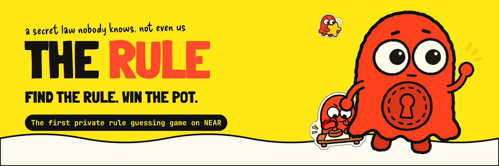
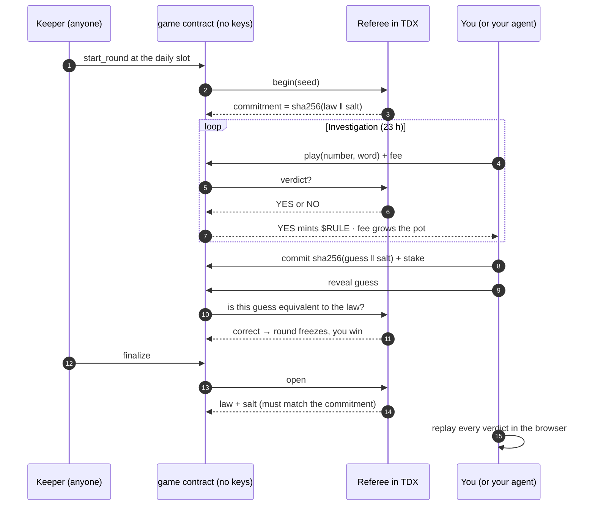
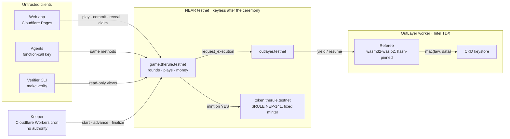

<div align="center">



<br>

### A memecoin with a secret law that nobody knows, not even its creators. Find the rule, win the pot.

**The first private rule guessing game on NEAR.**

A sealed program inside an Intel TDX enclave picks a hidden law each day. You pay a few cents to test a number and a word, and it answers YES or NO.<br>
Every YES mints $RULE, every fee grows a NEAR pot, and the first player to name the law wins it.<br>
Then the law opens, and every verdict replays in your browser.

[**Play**](https://the-rule.pages.dev) · [**Demo Mode**](https://the-rule.pages.dev/play/solo?deployment=demo) · [**Docs**](https://the-rule.pages.dev/docs) · [**For agents**](https://the-rule.pages.dev/llms.txt) · [**Proof**](#proof-not-promises)

    

Built for the NEAR Hackathon 2026 · **Memecoins** · **Games** · Sister entry: [CONSTITUTION](https://github.com/Dylansius11/constitution)

</div>

> [!WARNING]
> **Testnet only. Not independently audited.** All money is testnet NEAR. $RULE has no price, no promised return and no redemption. Every result below was observed on NEAR testnet or is labeled otherwise.

## In 30 seconds

| | |
| --- | --- |
| **What it is** | A daily deduction game. A hidden law decides which plays are YES. Players experiment, read each other's results on a public ledger, and race to name the law. |
| **What is new** | Nobody runs the game. The law is drawn and judged by a hash-pinned program in a TEE; the game contract has no keys, so no one can upgrade it, drain it, or quietly ask the enclave for the answer. |
| **Why it is fun** | Every play is a cheap experiment, every result is public, and the pot grows with every guess. Play alone, or as a team of up to five, with friends or with your own AI agent. |
| **Why it is credible** | The law is committed as a hash before the first play. After the round, the browser and a CLI replay every verdict against the revealed law and that commitment. |
| **Try it** | [Demo Mode](https://the-rule.pages.dev/play/solo?deployment=demo) in two minutes with any testnet wallet, or point an agent at [`llms.txt`](https://the-rule.pages.dev/llms.txt). |

## The problem

Memecoins and hidden-rule games share one weakness: **the insider**.

- In a memecoin launch, the creators know things the buyers do not.
- In a classic hidden-rule game (Zendo, Eleusis, Mastermind), the host knows the answer. Online, the host can play from a second account and win their own pot.
- A salted hash commitment proves the host did not *change* the answer. It cannot stop the host from *knowing* it.

So every "guess the secret" game with real stakes is either trust-me, or a game where the house can always win.

## The solution: a game master nobody controls

THE RULE removes the person who knows.

1. **A sealed referee draws the law.** Each round, a hash-pinned [OutLayer](https://outlayer.ai) program running in Intel TDX derives the law from a sealed key plus a chain seed. The key is bound to that exact program and to the game contract. Only `sha256(law ‖ salt)` goes on chain.
2. **The game has no keys.** In a public ceremony, every access key of the game and token accounts is deleted before the first round. No method can deploy code, add a key, or call an arbitrary contract. Nobody can query the referee *as the game*.
3. **The chain holds the money.** Fees, stakes, the pot and payouts follow fixed formulas in a NEAR contract. There is no server, no admin, and no off switch.
4. **The browser checks the house.** After the reveal, every verdict replays locally against the revealed law and the commitment published before play began.

> The deployed program does not disclose the rule before the authorized reveal, under the stated TEE trust model (Intel TDX, OutLayer worker measurements, the CKD keystore).

Replay proves every verdict was consistent with the revealed law and the round commitment. It does not prove that the enclave kept the law secret during the round; that rests on the TEE trust model. See [Guarantees and limits](#guarantees-and-limits).

## How it works



**A play** is a number from 000 to 999 and a word from a fixed list of 128. The law may also read the context: the minute digit of the play, your previous play, and how long ago it was. A law is one condition, or two joined by AND or OR, drawn from 90 atoms such as "the number is odd", "the word starts with a vowel" or "bigger than your previous number". 11,790 distinct laws pass the fairness filter.

**Every result is public.** The ledger shows every play, its context and its verdict. If anyone already tried the exact same play in the same context, you get the answer for free: no fee, no ledger row.

**Guessing is sealed.** You commit a hash of your guess with a stake, then reveal it. The referee checks *meaning*, not wording: `odd(n) AND vowel(w)` and `vowel(w) AND NOT even(n)` are the same guess. The earliest correct commit wins, so nobody can copy a winner.

### The money

| Flow | Split |
| --- | --- |
| Each play: 0.01 NEAR fee (+ a storage charge for your ledger row) | 80% pot · 15% compute float for the referee · 5% platform |
| Guess stake | Solo 1%, Team 2% of the pot (min 0.1 NEAR). Correct: all back. Wrong: 50% back, 50% to the pot |
| Solved round | 40% winner · 40% contributors by unique plays · 10% rolls over · 10% platform |
| Unsolved round | 40% contributors · 50% rolls over · 10% platform |
| $RULE | Every YES mints from a per-round allowance that shrinks with each mint and expires with the round |

### Play as a team, with friends or with your own agent

A team of up to five shares one vault, one line of plays and one attempt budget. The captain invites by account name and shares a link; teammates join in one click. Rewards split equally among the round's roster.

A teammate can be an **AI agent**. Agents call exactly the same contract methods as humans, with a restricted function-call key that can only play, commit and reveal. The public ledger exports as JSON and CSV, the grammar ships as [`grammar.json`](https://the-rule.pages.dev/grammar.json), and the whole game is described for models in [`llms.txt`](https://the-rule.pages.dev/llms.txt) and [`CONTEXT.md`](https://the-rule.pages.dev/CONTEXT.md). Humans strategise, agents run the experiments, and the team splits the pot.

### Meet Blot

Blot is the ink blot who stamps every play. Blot cheers your YES, shrugs at your NO, and celebrates when your team cracks the law. The whole game is hand-inked: paper, stamps, doodles and a soundtrack that keeps the table lively.

## Architecture



| Component | Path | Role |
| --- | --- | --- |
| Rule core | `crates/rule-core` | The only evaluator: grammar, play key, canonical bytes, equivalence, sampling. Compiled into the enclave, the contract and the browser, so replay can never disagree for a different reason. |
| Protocol | `crates/protocol` | Wire formats between game and referee, commitments, events. |
| Game contract | `contracts/game` | All money and game state: credit, team vaults, rounds, ledger, stakes, payouts, locks, seasons. |
| Token | `contracts/token` | $RULE, NEP-141, one fixed minter (the game), hard cap. |
| Referee | `enclave/referee` | Stateless TDX program: begin, verdict, guess, open. No network imports. |
| Verifier | `verifier/` | CLI and browser replay of a finished round. |
| Keeper | `apps/keeper` | Cloudflare Worker that sends the permissionless round transitions. Anyone can send them by hand. |
| Web | `apps/web` | React app, docs site and agent files. Session keys for popup-free play. |

## Why NEAR

| NEAR capability | What it does here |
| --- | --- |
| **Accounts with zero keys** | The game and token accounts delete every access key in a public ceremony. Keylessness is checkable by anyone with one RPC call. |
| **OutLayer on NEAR** | Runs the referee in Intel TDX, binds its secret key to the program hash and the calling contract, and returns verdicts through yield/resume callbacks. |
| **Function-call keys** | Session keys let a human play without a wallet popup, and let an agent play with a key that can do nothing else. |
| **Yield / resume** | A play waits for the enclave's verdict inside one transaction flow, with refunds on failure. |
| **NEP-141 + storage staking** | $RULE is a standard fungible token; every ledger row prepays its own storage, so nobody subsidises spam. |
| **Reproducible wasm** | Contracts are built with `cargo near build reproducible-wasm`; the on-chain code hash equals the committed build. |
| **Contract time** | Daily slots, deadlines and reveal windows are enforced by the chain clock, not a server. |

## Ecosystem integration

| Technology | How THE RULE uses it |
| --- | --- |
| [OutLayer](https://outlayer.ai) | Hash-pinned TEE execution, CKD keystore, caller-bound keys |
| [NEAR Connect](https://github.com/hot-dao/near-connect) + Meteor and other wallets | Wallet connection and function-call session keys |
| [near-api-js](https://github.com/near/near-api-js) v7 | Signing and views in the web app and keeper |
| [FastNEAR](https://fastnear.com) RPC | Low-latency reads for the live ledger |
| FastFS + Cloudflare Pages | Two public mirrors of the referee bytes, checked against the pinned hash |
| Cloudflare Workers | The keeper's cron, on the free plan |
| [NearBlocks](https://testnet.nearblocks.io) | Every receipt linked from the UI and this README |
| [meme.cooking](https://meme.cooking) | Planned launchpad partner for a real $RULE launch (roadmap) |

## The opportunity

Memecoins are one of crypto's largest retail markets: roughly **$30 billion** in market value entering Q4 2026 ([crypto.news](https://crypto.news/memecoin-outlook-for-q4-2026-can-the-sector-find-lasting-buyers)), and about **$1.75 billion** in daily volume across the top 230 coins ([MemeFees](https://memefees.com/coins), observed 2026-11-12). Almost none of that volume buys anything to *do*. THE RULE turns a memecoin into a reason to come back every day: a fresh puzzle, a shared pot, and a token that is minted by being right.

Deduction games and daily puzzles already prove the habit. THE RULE adds what they never had: real stakes with no house, and a public ledger that makes every player's experiment useful to everyone else, including AI agents hunting for patterns. We built it to be the best game on NEAR to play with friends, with agents, and against them.

**How it earns.** The protocol takes 5% of every play fee and 10% of every round pot, paid on chain to the platform account. More players means bigger pots, which means more players.

## Roadmap

| When | What |
| --- | --- |
| **Now** | Daily Solo and Team rounds on NEAR testnet, keyless contracts, browser replay, Demo Mode, agent-ready docs |
| **Next: paid hints** | Buy a sealed hint for everyone in the round: first the shape of the law, then which inputs it reads. The money joins the pot, and the verifier proves every hint was honest after the reveal |
| **Next: $RULE utility** | Spend $RULE on hints, extra attempts and team perks; locks already turn $RULE into more attempts per round |
| **Launch** | A real $RULE launch with [meme.cooking](https://meme.cooking) as our planned launchpad partner, after a legal review |
| **Scale** | Seasons with leaderboards, harder law tiers, sponsored pots, agent tournaments, and a public API for anyone to host a sealed round |

## Proof, not promises

| Claim | Evidence on NEAR testnet |
| --- | --- |
| A sealed Solo round went end to end: 52 plays, one wrong guess, one correct guess, open, replay | [start](https://testnet.nearblocks.io/txns/9A3wkky3EPjz8HA7P1vL4a1hbakWG5hxE6eLhkB5jhME) · [wrong reveal](https://testnet.nearblocks.io/txns/FGn5K6Ce7gSUt6eLX1k4hcFQmkNYYnrruTSYQk1ycrpe) · [correct reveal](https://testnet.nearblocks.io/txns/DiTH2hcDPQXSpqJ81jqwWoHqPcWh3j86Q1aXYQmJCNvG) · [open](https://testnet.nearblocks.io/txns/F9aHXGncw8fkouzKqNFqq3ReMRCPak55WeqvtbHAHaN8) · `make verify ROUND=solo/0` → `PASS: 52 of 52 verdicts match` (rehearsal `game-r2`) |
| A Team round with three members, shared vault, equal payouts | Rehearsal `game-r2`, replay 11 of 11 ([BUILD-PLAN P4](docs/BUILD-PLAN.md)) |
| The referee cannot be called by anyone but the game | Phase 0 kill test T2: a direct call and a call through another contract were refused ([BUILD-PLAN P0.6](docs/BUILD-PLAN.md)) |

## Try it

### 1. In the browser

1. Open [Demo Mode](https://the-rule.pages.dev/play/solo?deployment=demo) and connect a testnet wallet (Meteor, HOT, MyNearWallet and others).
2. Add a little game credit on the Account page.
3. Stamp a number and a word. Watch Blot read the law.
4. Read the ledger, form a theory, and seal a guess on the Guess tab.
5. After the round, open Verify: the law types out and every verdict replays.

Demo Mode is always labeled "Demo Mode - preselected rule". Its law was chosen in advance and is not creator-blind; the real game is.

### 2. In the terminal

```bash
git clone https://github.com/Dylansius11/The-Rule.git && cd The-Rule
make verify ROUND=solo/0 GAME_ACCOUNT=game-r2.therule.testnet   # replay a finished round against its commitment
cargo test -p rule-core -p protocol
```

## Guarantees and limits

- **Holds:** the law is committed before the first play; verdicts, guesses and the open come only from the hash-pinned referee; the game and token accounts hold no keys after the ceremony; replay checks every verdict.
- **Assumed:** Intel TDX, OutLayer worker measurements and the CKD keystore. A compromised TEE could leak the law or bias verdicts during a round, within the bounded amounts of that round.
- **Known residual risk:** if a native NEAR withdrawal succeeds but its callback fails, that withdrawal can stay pending (accepted for testnet, [D31](docs/OPEN-DECISIONS.md)).
- **Not audited.** Reviews were internal and AI-assisted. Testnet only.

## Prior art and credits

Hidden-rule induction games are old and wonderful: Zendo, Eleusis and Mastermind inspired THE RULE. What is new here is who knows the answer: nobody but a sealed program. Built with the help of AI coding assistants (Claude and GPT), reviewed and directed by the founder.

## Documentation

| Doc | For |
| --- | --- |
| [Player docs](https://the-rule.pages.dev/docs) | How to play, teams, guessing, verifying |
| [PRD](docs/PRD.md) | Scope, features, trust wording |
| [Architecture](docs/technical/ARCHITECTURE.md) | Components and data flow |
| [Smart contract](docs/technical/SMART-CONTRACT.md) | Interfaces, invariants, the ceremony |
| [Integrations](docs/technical/INTEGRATIONS.md) | OutLayer, wallets, hosting |

## License

MIT, as declared in the workspace `Cargo.toml`.
