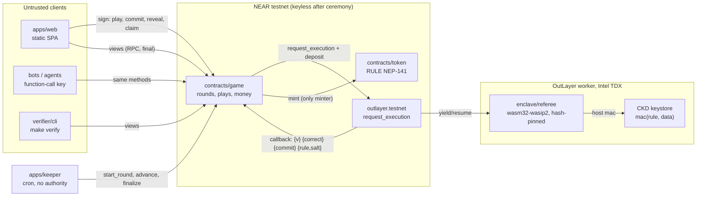
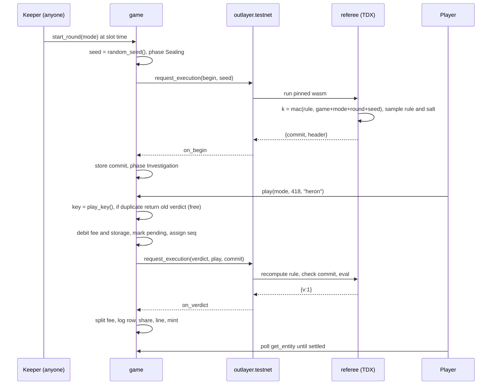
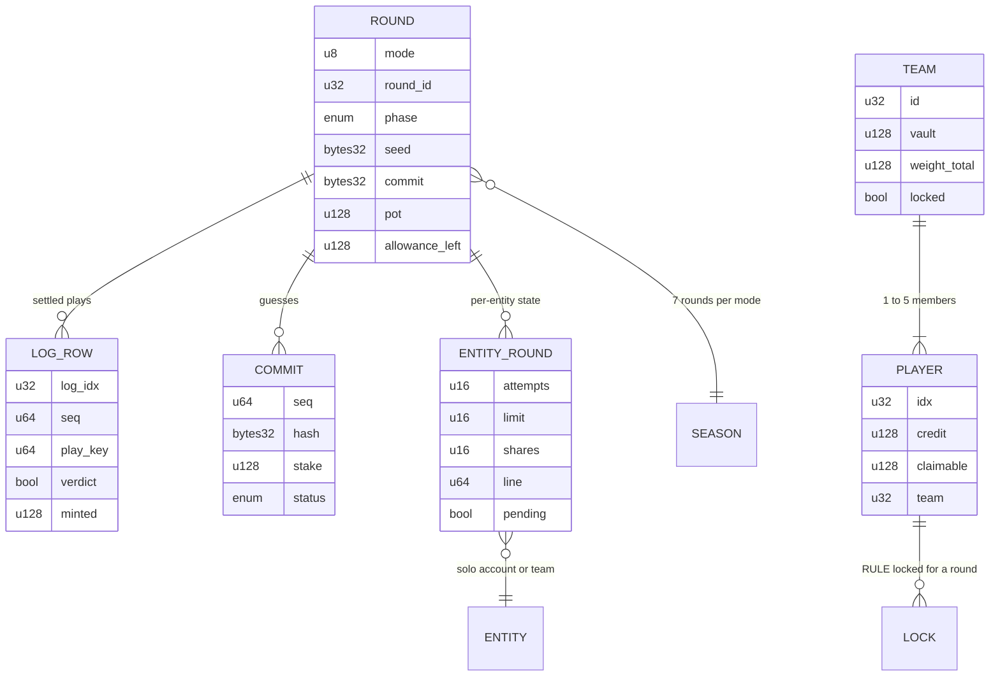

# THE RULE: architecture

## TL;DR and approval

- **Status (2026-11-05):** core stack approved (D1); shared core, referee/verifier, Solo game/token and bounded Team custody paths are implemented and locally tested with MOCK OutLayer. Operator collateral is separately budgeted and new-round admission cannot borrow player/pot/compute money. Unknown-outcome external-effect recovery remains an explicit B6 architecture gate. Phase 0 probe receipts are testnet evidence, not a real-game rehearsal. Frontend platform (D2), visual references (B1), keeper deployment and remaining BUILD-PLAN acceptances are still open.
- **Shape:** the chain is the backend. Two NEAR contracts hold all money and state. One OutLayer TDX program holds the rule. One Rust crate, `rule-core`, defines the rule, compiled three ways: the enclave (`wasm32-wasip2`), the game contract (`wasm32-unknown-unknown`) and the browser/CLI verifier. A static web app and a permissionless keeper have no authority.
- **Core invariant:** no component except the pinned referee can compute the rule before the reveal, and no referee output can name an account or an amount.

## System diagram and responsibilities



Trust boundaries: clients and the keeper are untrusted. The game and token contracts are trusted code with no keys. OutLayer and the TEE are trusted under the stated TEE model and are the residual trust root.

| Component | Inputs | Outputs | Owned state |
| --- | --- | --- | --- |
| `crates/rule-core` | Plays, canonical rules, seeds | Verdicts, canonical bytes, sampled rules, equivalence | None (pure) |
| `crates/protocol` | Referee and contract wire data | Typed requests and responses, commit preimages, events | None (pure) |
| `contracts/game` | Signed calls, OutLayer callbacks, `ft_on_transfer` | Events, views, OutLayer requests, mints, transfers | All game and money state (SMART-CONTRACT) |
| `contracts/token` | `mint` from the minter, NEP-141 calls | Balances, events | NEP-141 state, cap |
| `enclave/referee` | stdin JSON `RefereeRequest`, host `mac` | stdout JSON `RefereeResponse` | None (stateless) |
| `verifier/cli`, `verifier/wasm` | Log pages, rule, salt, commitment | PASS or first mismatch | None |
| `apps/web` | User input, RPC views, wallet | Signed transactions, exports | Browser-local only (guess salts, hypotheses) |
| `apps/keeper` | Clock, RPC views | Permissionless transition txs, heartbeat | None; one gas-only key |

## Data flow

### Round start and play (F1, F2)



### Guess, freeze and reveal (F5, F6)

1. `commit_guess(hash)`: the stake is locked at the current pot percentage, and the commit gets `seq`.
2. At least 2 blocks later, `reveal_guess(guess, salt)`: the contract checks the preimage and tier, then sends referee `guess`, which runs the exact equivalence check over the full legal domain and returns `{correct}`.
3. The first `correct:true` applied freezes the round. New plays and commits are rejected; in-flight plays refund. Earlier commits may still reveal until `freeze + 30 min`.
4. `finalize`: unrevealed commits are settled as wrong; the outcome is chosen by minimum `seq`; referee `open` returns `{rule, salt}`; the contract checks `sha256(rule||salt) == commit` and moves to Settled (or Void).
5. Clients run `verify_round` in the browser worker and `make verify` in the terminal: commitment check plus N of N verdict replay.

### Failure and timeout

- OutLayer returns JSON `null` on guest failure or missing output, and a promise error on yield timeout (200 blocks on testnet, [V] protocol config 2026-11-04). The game treats both as **system failure**: full refund of the fee or stake, attempt restored, and no verdict.
- `begin` failure: retry until `begin_timeout`, then Cancelled (no plays happened). `open` failure: `retry_open` until `open_timeout`, then Cancelled with exact refunds. Hash mismatch: Void.
- A keeper outage delays transitions only. Anyone can call them.

For a begin/verdict/guess/open callback or a read-only token registration check that never completes, permissionless `expire_request(request_id)` applies its failure handler after ten minutes from initiation. The original id is consumed, so late callbacks cannot settle twice or mutate a replacement request. Registration resets to unconfirmed without moving money or changing referee admission; a fresh check is required before minting. Begin/open still use their existing round retry/cancel deadlines. This is a local recovery policy, not an OutLayer SLA. Withdraw/platform payments, mint and unlock remain excluded because their unknown external side effects cannot safely be refunded blindly; their reconciliation remains B6.

## Approved tech stack

| Layer | Choice | Exact stable version | Verified 2026-11-04, source | Why / compatibility |
| --- | --- | --- | --- | --- |
| Contracts | near-sdk, near-contract-standards | 5.30.0 | [crates.io](https://crates.io/api/v1/crates/near-sdk) | MSRV 1.95, min protocol 88 = live testnet 88 |
| Contract build | cargo-near | 0.22.0 | [crates.io](https://crates.io/api/v1/crates/cargo-near), [GitHub release](https://api.github.com/repos/near/cargo-near/releases/latest) | `reproducible-wasm` with image `sourcescan/cargo-near:0.22.0-rust-1.97.1` |
| Rust toolchain | rustc | 1.97.1 | cargo-near template image tag | Same compiler in the image; OutLayer WASI compiler image uses `rust:1.97` |
| Referee | outlayer SDK, target `wasm32-wasip2` | 0.2.1 | [crates.io](https://crates.io/api/v1/crates/outlayer), [docs](https://app.outlayer.ai/docs/sdk) | Host `mac`, stdin/stdout JSON; plain `cargo build --target wasm32-wasip2` |
| Component tooling | wasm-tools (import audit) | 1.240.0 | [OutLayer compiler Dockerfile](https://raw.githubusercontent.com/out-layer/outlayer/main/docker/Dockerfile.wasmedge-compiler) | Same version as the vendor image |
| Shared core | serde / borsh / sha2 | 1.0.229 / 1.8.1 / 0.11.1 | crates.io API | Canonical bytes are hand-specified, not serializer defaults |
| Browser bindings | wasm-bindgen + wasm-bindgen-cli | 0.2.130 (matched) | [crates.io](https://crates.io/api/v1/crates/wasm-bindgen) | `--target web`, loaded in a module worker; no wasm-pack required |
| Sandbox tests | near-workspaces | 0.24.0 | [crates.io](https://crates.io/api/v1/crates/near-workspaces) | Linux/macOS sandbox host: run in WSL |
| Property / fuzz | proptest; cargo-fuzz | 1.12.0; 0.13.2 | crates.io API | cargo-fuzz needs Linux nightly: WSL or CI |
| JS runtime | Node LTS; pnpm | 26.13.0; 12.16.1 | [Node releases](https://nodejs.org/en/about/previous-releases), `npm view pnpm` | near-api-js requires Node >= 22.22.2 |
| NEAR JS | near-api-js | 7.4.0 | `npm view near-api-js` | Views, keeper signing, web |
| Frontend (D2, proposed) | React, Vite, TypeScript, Motion, TanStack, NEAR Connect | 19.3.1, 8.3.5, 6.0.3, 14.9.1, Query 5.105.3 / Table 9.3.1 / Virtual 3.14.26, 0.12.0 | npm registry, 2026-11-04 | Visual direction open (B1) |
| Hosting | Cloudflare Pages (web); FastFS testnet + raw GitHub mirror (referee bytes) | managed | [Pages limits](https://developers.cloudflare.com/pages/platform/limits/), [OutLayer dev guide](https://app.outlayer.ai/docs/dev-guide) | OutLayer source follows up to 3 HTTPS redirects and caps wasm at 10 MiB [V] |
| Keeper (D20, proposed) | Cloudflare Workers Cron; fallback GitHub Actions schedule | managed | [Workers limits](https://developers.cloudflare.com/workers/platform/limits/) | 10 ms CPU per invocation; signing qualification B5 |
| Monitor | Healthchecks.io Hobbyist | managed | [pricing](https://healthchecks.io/pricing/) | Missed-heartbeat alert |

Alternatives, recommendation and founder approval live in OPEN-DECISIONS D1, D2, D20. Versions are live observations of 2026-11-04 and are pinned in lockfiles at P0.3.

## Codebase structure and interfaces

```text
the-rule/
  CLAUDE.md  README.md  Makefile  Cargo.toml  rust-toolchain.toml
  package.json  pnpm-workspace.yaml  .env.example  skills-lock.json
  crates/
    rule-core/          grammar g1: words, atoms, Play, play_key, canonical rule, eval, sample, equivalent
    protocol/           RefereeRequest/Response, commit preimage, params, events, domain constants
  contracts/
    game/               src/{lib,params,round,play,log,guess,settle,cancel,credit,stake,payout,claim,team,mint,lock,season,ledger}.rs
    token/              NEP-141/145/148 RULE, minter-only capped mint
  enclave/
    referee/            wasm32-wasip2 guest: begin/verdict/guess/open; manifest; IMPORTS.txt; feature `demo`
  verifier/
    cli/                native `rule verify` (make verify)
    wasm/               wasm-bindgen package @the-rule/verifier-wasm
  apps/
    web/                frontend SPA (Phase 7, blocked on B1)
    keeper/             scheduled permissionless transitions
  bots/                 house bots and agent runner (P1)
  tests/
    sandbox/            near-workspaces cross-contract tests with mock OutLayer
    vectors/            golden JSON vectors used by every target
  scripts/              probe/, referee/, ceremony/, demo/, deploy/
  spikes/               Phase 0 probes; deleted or reduced to tests after Phase 2
  docs/                 PRD, BUILD-PLAN, OPEN-DECISIONS, LESSONS, technical/
  scratch/              gitignored working files
```

Rules that keep this navigable as it grows:

- **Dependency direction:** `rule-core` <- `protocol` <- {`contracts/game`, `enclave/referee`, `verifier/*`}. `contracts/token` depends on nothing project-internal. Apps depend only on `verifier/wasm` and contract views. Nothing imports from `apps/`.
- **One owner per concept:** grammar only in `rule-core`; wire formats only in `protocol`; money only in `contracts/game`. A second evaluator or encoder anywhere is a review failure.
- **No target leakage:** `rule-core` and `protocol` have no `near-sdk`, `wasm-bindgen`, WASI, clock, RNG or I/O dependency, and no default features. Each adapter crate enables only its own target dependencies. T-ENC compiles the vectors on all three targets.
- **Contract modules** are one concern per file. `lib.rs` holds only the `#[near]` surface and delegates; checks happen before effects, and effects before calls.
- **JS packages** are pnpm workspace members: `apps/web`, `apps/keeper`, `verifier/wasm` (built output), `bots`. Cargo workspace members: `crates/*`, `contracts/*`, `enclave/referee`, `verifier/cli`, `tests/sandbox`.

Cross-component types (all in `protocol`, Borsh for state, JSON for the wire): `Mode`, `Entity`, `Play`, `PlayKey(u64)`, `CanonicalRule`, `RoundHeader`, `RefereeRequest`, `RefereeResponse`, `CommitPreimage`, `LogRow`, `Params`. Exact layouts are in [SMART-CONTRACT](SMART-CONTRACT.md#encodings-and-invariants).

## ERD and data model



- **Public:** all contract state is publicly readable through RPC, including pending plays and stakes. Nothing secret is stored on chain. The rule and salt appear only after `open`.
- **Private:** the rule exists only inside TEE runs. Guess salts and local hypotheses stay in the player's browser (export button), never on our servers. Keys stay in the wallet, the agent's keystore, or the local `.env` for operator accounts.
- **Retention:** log rows are permanent (storage paid per play). There is no off-chain database.

## Failure modes

| Failure | Detection | User-visible state | Recovery | Test |
| --- | --- | --- | --- | --- |
| Referee error or `null` output | Callback parse | "Refunded: the referee did not answer" | Full refund | T-CB-1 |
| Yield timeout | Promise error in callback | Same as above | Full refund | T-CB-3 (mock) |
| Duplicate or late callback | `pending` lookup miss | None | Ignored | T-CB-2 |
| Begin never succeeds | `begin_timeout` | "Round cancelled" | `cancel`, next slot | T-ROUND-6 |
| Open never succeeds | `open_timeout` | "Round cancelled, refunds available" | Exact refunds | T-ROUND-7 |
| Commitment mismatch at open | Hash check | "Round void: referee fault" | Refunds plus public evidence | T-ROUND-8 |
| Mint fails | Mint callback | Verdict YES, "mint failed" | Allowance restored | T-TOK-4 |
| Compute float too low | E22 at play | "Paused: compute float low" | `seed_pot` cannot help; refill by fees or a sponsor `fund_compute` call (P2.4) | T-PLAY-9 |
| RPC rate limit | Client HTTP 429 | "Loading, retrying" with progress | Backoff, fallback endpoint | web unit tests |
| Keeper down | Missed heartbeat, overdue phase view | Phase shows "waiting for anyone to advance" plus a button | Manual or any account call | keeper dry-run |
| Wallet rejects or user cancels | Wallet error | Nothing charged | Retry | e2e |

## Security model

- **Assets:** NEAR in credit, vaults, pots, stakes and floats; RULE supply integrity; rule secrecy until reveal; fairness of the winner order.
- **Adversaries:** players and bots (including Sybils), the creator before and after deployment, the keeper operator, validators ordering transactions, a malicious or faulty referee/TEE, RPC providers serving wrong data to the browser.

| Actor | Can | Cannot |
| --- | --- | --- |
| Player / agent | Play, commit, reveal, claim, transfer RULE | Withdraw with a function-call key (1 yocto); change verdicts; reveal another's commit |
| Creator after ceremony | Play like anyone | Upgrade, add keys, query the referee as `game`, choose a rule |
| Keeper | Call due transitions, pay gas | Choose seeds, winners or amounts; skip timeouts |
| Validator | Order and censor transactions; see the seed | Learn the MAC key; reorder committed `seq` |
| Referee (if compromised) | Bias verdicts, leak the rule | Name recipients or amounts; exceed the allowance or pot formulas |
| RPC provider | Serve stale or wrong views | Make `make verify` pass against a different provider (cross-check endpoints) |

Invariants I1 to I13 and the bypass analysis are in SMART-CONTRACT. Input validation lives at the contract boundary (word list, number range, canonical rule parsing, strict referee schema). Replay binding: the round key, request id and commit seq are bound into every pending request, so callbacks apply once.

**Residual risks:** TEE or keystore compromise (passive leak undetectable); side channels in the referee (fixed-shape output reduces but does not remove them); OutLayer liveness; public-grammar bots solve fast (accepted as the benchmark baseline); Sybil accounts bypass per-entity caps (bounded by fees and global allowance).

## Deployment and verification

| Environment | Accounts | Keys | Purpose |
| --- | --- | --- | --- |
| Sandbox (WSL) | local | local | T-* sandbox suite with mock OutLayer |
| Testnet probe | `probe-game`, `probe-other` | kept | Phase 0 kill test |
| Testnet rehearsal | `game-r<N>`, `token-r<N>` | kept | P2.9 and P8 dry runs with the real referee |
| Testnet demo | `demo-game`, `demo-token` | kept | Demo Mode (labeled) |
| Testnet production | `game`, `token` | deleted at P8.2 | Real sealed rounds |

Planned verification commands (**planned, not run**): `make test` (cargo tests + vectors + web unit), `make sandbox` (WSL), `make vectors`, `make build-contracts` (`cargo near build reproducible-wasm`), `make build-referee` (pinned image, prints sha256), `make verify ROUND=solo/3`, `make verify-wasm` (rebuild and compare deployed hashes).

## Sources

All read 2026-11-04 unless stated: OutLayer [near-integration](https://app.outlayer.ai/docs/near-integration), [encryption-keys](https://app.outlayer.ai/docs/encryption-keys), [manifest](https://raw.githubusercontent.com/out-layer/outlayer/main/wasi-examples/CONNECTOR_MANIFEST.md), [WIT](https://raw.githubusercontent.com/out-layer/outlayer/main/worker/wit/deps/encryption-keys.wit), [execution source](https://raw.githubusercontent.com/out-layer/outlayer/main/contract/src/execution.rs), [trust](https://app.outlayer.ai/docs/trust-verification); NEAR [access keys](https://docs.near.org/protocol/accounts-contracts/access-keys.md), [yield/resume](https://docs.near.org/smart-contracts/anatomy/yield-resume.md), [randomness](https://docs.near.org/smart-contracts/security/random.md); testnet RPC `EXPERIMENTAL_protocol_config` and `outlayer.testnet` views (blocks 276188426 to 276188511); design dossier sources/28 and red team sources/27 (2026-11-02). Unverified prerequisites: the full contract-initiated wasm-bound key path (Phase 0), sandbox yield behavior, Workers signing (B5), NEAR Auth compatibility (B4).
