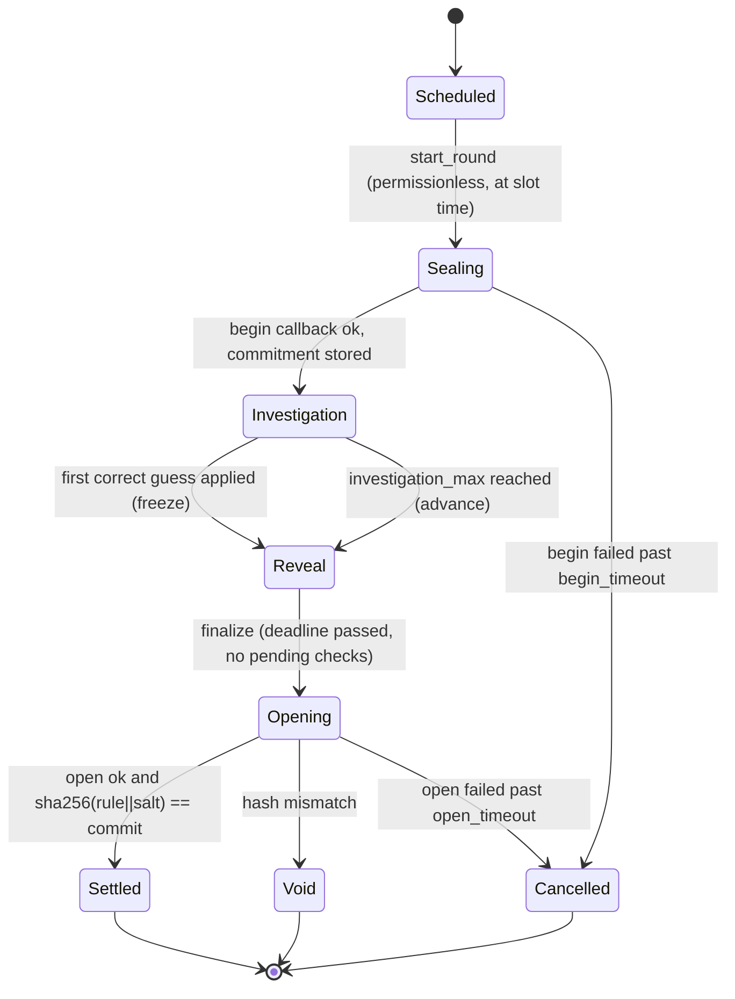

# THE RULE: smart contract specification

This is the protocol contract between the game contract, the token contract, the OutLayer referee, the verifier and every client. It is a design, **not a deployment or an audit**. Nothing below has run on any network yet (status 2026-11-04).

## TL;DR and necessity

- Two NEAR testnet contracts. `game` holds all money and game state: play credit, team vaults, pots, stakes, rounds, the public verdict log, payouts and RULE locks. `token` is a plain NEP-141 RULE with one fixed minter (`game`) and a hard supply cap.
- The hidden rule lives only in a hash-pinned OutLayer referee (`enclave/referee`, `wasm32-wasip2`, Intel TDX). The game contract calls it with `request_execution` and accepts only four tiny, strictly parsed answers: `{commit, header}`, `{v}`, `{correct}`, `{rule, salt}`. No answer can name an account or an amount.
- Why on chain [I]: the pot, stakes and payouts need custody nobody can switch off. The play log needs a public append-only order, so "earliest correct commit wins" means chain order and not callback speed. Contracts with no access keys remove the creator's own bypass.
- **Guarantee [I]:** after the key-deletion ceremony, the deployed program does not disclose the rule before the authorized reveal. This holds only under the stated TEE trust model: Intel TDX, OutLayer worker measurements, and the CKD keystore. After the reveal, anyone can check that every verdict matches the revealed rule and the round's commitment.
- **Limit:** the browser replay proves the verdicts were consistent with the revealed rule. It does not prove that the enclave kept the rule secret during the round. A compromised TEE or keystore could leak the rule or bias verdicts. The amounts it could affect are bounded by the formulas below.
- Founder decisions applied here are listed in [OPEN-DECISIONS](../OPEN-DECISIONS.md) D3 to D19. Every number marked "param" is fixed at `new()` and immutable. There are no setters.

## Accounts and authority

| Account (planned, D21) | Holds | Keys after ceremony |
| --- | --- | --- |
| `therule.testnet` | Parent; funds sub-accounts | Founder/lead full-access key (parent cannot control existing children [V](https://docs.near.org/protocol/accounts-contracts/account-id.md)) |
| `game.therule.testnet` | Game contract, all NEAR liabilities | **None.** Every access key is deleted before the first production round (ceremony below) |
| `token.therule.testnet` | RULE NEP-141 | **None.** Deleted in the same ceremony |
| `keeper.therule.testnet` | Pays gas for permissionless transitions | Its own full-access key in the keeper secret store; it holds no authority over the game |
| `platform.therule.testnet` | Receives platform share via `claim_platform` | Founder |
| `demo-game.therule.testnet`, `demo-token.therule.testnet` | Demo Mode instance (D17) | **Keys retained** and labeled not creator-blind |

The game account name is compiled into the referee manifest (`callers.contract.only`). Renaming it means a new referee hash, which means a new key and a new rule stream. Rehearsals use `game-r<N>.therule.testnet` with their own referee build.

## Storage and state machine

### Units and encodings

- NEAR amounts are `u128` yoctoNEAR, serialized as JSON strings. RULE amounts are `u128` with 18 decimals, also JSON strings. Time is `u64` nanoseconds from `env::block_timestamp()`. Basis points (`bps`) are `u16` with 10,000 = 100%.
- State uses Borsh with `near_sdk::store` collections and explicit storage prefixes. Accounts are interned to a `u32` index (`AccountIdx`) to keep log rows small.
- `Mode = Solo | Team` (`u8` 0, 1). `RoundKey = (Mode, round_id: u32)`. `Entity = Solo(AccountIdx) | Team(team_id: u32)`. In Team mode the team, not the member, is the player: one line, one attempt budget, one pending play, one stake.

### Params (set once in `new`, immutable)

| Param | Production default [I] | Demo default [I] | Note |
| --- | --- | --- | --- |
| `play_fee` | 0.01 NEAR | 0.01 NEAR | D3 |
| `fee_split_bps` pot / compute / platform | 8000 / 1500 / 500 | same | D3; 80/10/10 only after T4 data and a new deployment |
| `storage_charge_per_play` | measured in P2.4, est. 0.0013 NEAR | same | Separate line item. It is not pot money (see invariant I2) |
| `storage_charge_account` / `storage_charge_team` | measured in P2.4, est. 0.003 / 0.005 NEAR | same | Charged once from the first deposit or team creation into `storage_reserve` |
| `stake_bps` solo / team | 100 / 200 | same | D10; of the pot at commit |
| `stake_min` | 0.1 NEAR | 0.1 NEAR | D10 |
| `wrong_return_bps` | 5000 | same | D11; the other half goes to the pot |
| `solved_split_bps` winner / contributors / rollover / platform | 4000 / 4000 / 1000 / 1000 | same | D5 |
| `unsolved_split_bps` contributors / rollover / platform | 4000 / 5000 / 1000 | same | D6 |
| `genesis_ns` | first production slot, after ceremony | any | Round `r` of mode `m` starts at `genesis_ns + r * round_period_ns + mode_offset_ns[m]` |
| `round_period_ns` | 24 h | 15 min | D14 |
| `mode_offset_ns` solo / team | 0 / 12 h | 0 / 0 | Staggers the two daily rounds [I] |
| `investigation_max_ns` | 23 h | 10 min | Investigation ends here if unsolved |
| `reveal_window_ns` | 30 min | 2 min | From freeze or investigation end |
| `begin_timeout_ns` / `open_timeout_ns` | 1 h / 6 h | 5 min / 10 min | Then Cancelled (D7) |
| `min_reveal_delay_blocks` | 2 | 2 | Commit and reveal never share a block |
| `base_attempts` solo / team | 25 / 50 | same | D16; per round |
| `lock_tiers` (RULE locked to extra attempts) | 1,000 to +25; 5,000 to +50; 20,000 to +100 | same | D16; highest tier reached |
| `attempt_cap` solo / team | 125 / 250 | same | Hard cap |
| `share_cap` solo / team | 25 / 50 | same | D8; contributor shares per entity per round |
| `round_allowance` | 500,000 RULE per mode per round | 50,000 | Expires at round end; never pre-minted |
| `mint_base` | 100 RULE | same | Per ACCEPT, scaled below |
| `max_team_size` | 5 | 5 | D15 |
| `referee` | `{outlayer: outlayer.testnet, urls: [primary, mirror], hash, build_target: "wasm32-wasip2"}` | demo referee | All URLs serve identical bytes |
| `resource_limits` per op | begin 10 s, verdict 5 s, guess 30 s, open 10 s; instructions/memory set from T4 | same | Always passed; `None` means compile-only [V](https://raw.githubusercontent.com/out-layer/outlayer/main/contract/src/execution.rs) |
| `outlayer_deposit` per op | `estimate_execution_cost` for those limits plus 20% margin, measured in Phase 0 | same | Paid from the compute float |
| `gas` | OutLayer call 100 Tgas, callback 30 Tgas, mint 10 Tgas | same | Starting values; measured in P2.6 |
| `token`, `platform`, `chain_id` | accounts above, `"testnet"` | demo accounts | |

### Contract state (game)

```text
Game {
  params: Params
  accounts: LookupMap<AccountId, AccountIdx>        // interning, append-only
  players: LookupMap<AccountIdx, Player>            // credit, claimable, team, rule_registered flag
  teams: LookupMap<u32, Team>                       // members (<= 5), invites, vault, lock state
  rounds: LookupMap<RoundKey, Round>
  current: [Option<u32>; 2]                         // active round id per mode
  carry: [u128; 2]                                  // rollover waiting for the next round of that mode
  log: LookupMap<RoundKey, Vector<LogRow>>          // settled verdicts, append-only, paged view
  seen: LookupMap<(RoundKey, u64 play_key), u32>    // play_key -> log index or PENDING
  pending: LookupMap<u64 request_id, Request>       // in-flight OutLayer calls
  commits: LookupMap<(RoundKey, u32 commit_seq), Commit>
  entity_round: LookupMap<(RoundKey, Entity), EntityRound> // attempts, shares, line, pending flag, locks
  seasons: LookupMap<(Mode, u32 season), SeasonBoard>
  compute_float: u128, platform_accrued: u128, storage_reserve: u128
  next_request_id: u64, next_seq: u64                // global contract sequence for plays and commits
}

Round { phase, seed: [u8;32], commit: [u8;32], header: RoundHeader, pot: u128,
        allowance_left: u128, minted: u128, best: Option<(commit_seq, Entity)>,
        freeze_ns: Option<u64>, reveal_deadline_ns: u64, pending_checks: u32,
        total_shares: u64, outcome: Option<Outcome>, rule: Option<CanonicalRule>, salt: Option<[u8;32]> }
LogRow { log_idx: u32, seq: u64, entity: Entity, actor: AccountIdx, play: Play, verdict: bool, minted: u128 }
Commit { seq: u64, entity: Entity, actor: AccountIdx, hash: [u8;32], stake: u128, block: u64, status: Committed|Checking|Correct|Wrong|Refunded|Unrevealed }
```

`Play` and `play_key` are defined by `rule-core` (Encodings). A `LogRow` holds every field the verdict depends on, so replay needs only the log, the rule and the salt.

### Round phases



- **Investigation:** plays and new commits are accepted. Reveals of existing commits are also accepted, so a confident player can end the round early.
- **Freeze:** when the first `correct: true` guess result is applied, the round moves to Reveal at once. New plays and new commits are rejected. Plays still in flight are refunded with no mint and no share. Existing commits may reveal until `reveal_deadline_ns = freeze_ns + reveal_window_ns`.
- **Winner:** the Correct commit with the smallest `seq`, never the first callback. A later Correct commit gets its stake back but no win.
- **Outcome:** `Solved{winner}` if any commit is Correct at finalize, otherwise `Unsolved`. Payouts become claimable only in Settled, after the hash check. This is "proof before money".
- **Next round:** the next round of a mode cannot start before its slot time and before the previous round of that mode has left Investigation and Reveal. One round per day per mode; a solved round leaves the rest of its day empty.

## Public interfaces

`[fck]` means callable with a function-call access key (no deposit). `1y` means exactly 1 yoctoNEAR must be attached, which forces a full-access key because function-call keys cannot attach deposits ([V](https://docs.near.org/protocol/accounts-contracts/access-keys.md)). Panics use stable codes `E<nn>` (table below). Every mutating method checks, in order: phase, caller authority, input bounds, balances; then it writes state, then makes external calls.

### Credit, teams, locks

| Method | Caller | Effect |
| --- | --- | --- |
| `deposit_credit()` payable | anyone | Adds the deposit to the caller's credit. The first deposit interns the account and charges `storage_charge_account` |
| `withdraw_credit(amount)` `1y` | owner | Pays credit out. Rejected while the caller has a pending play or a Checking guess (E21) |
| `create_team(name)` | anyone not in a team | New team with caller as captain; `name` 3 to 24 chars `[a-z0-9-]` |
| `invite(account)` / `join_team(team_id)` / `leave_team()` / `remove_member(account)` | captain / invitee / member / captain | Roster changes only while the team is not locked (E30). Size never exceeds 5 (E31) |
| `team_deposit(team_id)` payable | member | Vault += deposit; depositor weight += deposit |
| `team_withdraw(team_id)` `1y` | depositor | Only while unlocked. Pays `vault * w_i / W` (floor), then reduces vault and `W` by the same amounts, so the remaining depositors keep exact pro-rata claims |
| `ft_on_transfer(sender, amount, msg)` | `token` only (E40) | `msg = {"lock":{"mode":0|1,"round_id":r}}` locks RULE for Scheduled round `r`. For Team mode the sender's team receives the lock. Returns `"0"` (all used) or the full amount on any rejection |
| `unlock(mode, round_id)` | locker | After Settled, Cancelled or Void: transfers the caller's locked RULE back. Never forfeited (D16) |

A team is locked from its first play or commit in a round until that round is Settled, Cancelled or Void.

### Plays

`play(mode, number: u16, word: String) -> PlayAck` `[fck]`

1. Round of `mode` is in Investigation (E10). Caller's entity is resolved: Solo is the caller; Team is the caller's team (E32 if none).
2. `number <= 999`; `word` is normalized (trim ASCII whitespace, ASCII lowercase) and must be in the published 128-word list (E11). Normalization is part of `rule-core` grammar `g1`.
3. Build `Play{number, word_id, minute_digit, prev}` from the block timestamp and the entity's line (its last ACCEPT this round), then compute `play_key`.
4. **Duplicate:** if `seen` has `play_key` with a settled verdict, return `PlayAck::Known{verdict, log_idx}`. No fee, no state change, no enclave call, no mint, no share, no log row (D9). If it is PENDING, panic E12 (nothing charged).
5. Entity has no pending play (E13) and attempts used < attempt limit (E14).
6. Debit `play_fee + storage_charge_per_play` from the payer: the caller's credit (Solo) or the team vault (Team). Insufficient: E20. `compute_float` must cover `outlayer_deposit.verdict` (E22, play rejected rather than borrowing from the pot).
7. Assign `seq`, mark `seen[play_key] = PENDING`, store `Request{Verdict, round, entity, actor, play, seq}`, increment attempts, set entity pending.
8. Call `outlayer.request_execution(...)` with the `verdict` input, then `.then(on_verdict(request_id))`. Return `PlayAck::Pending{request_id, seq}`.

`on_verdict(request_id)` `#[private]`, never panics after loading the request:

- Parse the promise result strictly as `{"v":0|1}`. Anything else, JSON `null` (OutLayer's failure encoding [V](https://raw.githubusercontent.com/out-layer/outlayer/main/contract/src/execution.rs)), a promise error, a wrong round, or a round that has left Investigation leads to **refund**: credit back fee + storage charge, attempt restored, `seen` entry removed, pending cleared, event `play_refunded{reason}`.
- On a valid verdict: pot += 80% of fee, compute_float += 15%, platform_accrued += 5%. Append the `LogRow`. Set `seen[play_key] = log_idx`. Shares += 1 if under `share_cap`, and `total_shares` += 1 likewise. If ACCEPT, advance the line and mint (below). Clear pending. Event `play_settled`.
- Mint on ACCEPT: `m = mint_base * allowance_left / round_allowance * bucket_bps / 10_000`, with bucket 10000 Rare, 5000 Mid, 2500 Common from the round header. If `m > 0`: `allowance_left -= m`, then `token.mint(recipient, m)` with the recipient's first-mint storage deposit charged from their credit (Solo) or the vault (Team). Team mints go to the acting member. A failed mint callback restores `allowance_left`, refunds the storage charge, and records `minted = 0` on the row with event `mint_failed`. The verdict stands.

### Guesses

`commit_guess(mode, hash: Base64[32]) -> CommitAck` `[fck]`

- Investigation only (E10). Entity has fewer than 3 open commits this round (E15) [I].
- Stake = `max(stake_min, pot * stake_bps[mode] / 10_000)` from the current pot, debited now from credit or vault (E20). Stored with `seq` and `block`. The stake is fixed at commit and never recomputed.

`reveal_guess(mode, commit_seq, guess: CanonicalRule, salt: Base64[32])` `[fck]`

- Round is in Investigation or Reveal and before `reveal_deadline_ns` (E16). Caller is the commit's `actor` (E17). Commit status is Committed and `block_height >= commit.block + min_reveal_delay_blocks` (E18).
- `sha256(commit_preimage(...)) == hash` (E19). `guess` parses and fits the round's tier (E11). Otherwise the reveal panics and the commit stays Committed; it can still be revealed correctly before the deadline.
- Status becomes Checking, `pending_checks += 1`, call referee `guess`, then `.then(on_guess(request_id))`.

`on_guess`: `{"correct":true}` sets Correct. If no freeze yet, freeze now. `best` = min(best, seq). `{"correct":false}` sets Wrong: 50% of the stake goes to the payer's claimable balance (Solo credit, Team vault) and 50% to the pot. Any failure sets **Refunded**: the full stake returns and the commit may not be revealed again (D7). `pending_checks -= 1`. There is no counterexample, ever (D11).

### Round lifecycle (permissionless; the keeper calls them, anyone may)

| Method | Precondition | Effect |
| --- | --- | --- |
| `start_round(mode)` | Slot time reached, previous round of mode out of Investigation/Reveal, no round Sealing | Creates the round, `seed = env::random_seed()`, moves `carry[mode]` into the pot, `allowance_left = round_allowance`, calls referee `begin`. A retry is allowed if a begin request failed and `begin_timeout` has not passed |
| `advance(mode)` | Investigation and `now >= investigation_end_ns` (`begin_ok_ns + investigation_max_ns`) | Moves to Reveal with `reveal_deadline = now + reveal_window` |
| `finalize(mode)` | Reveal, `now >= reveal_deadline`, `pending_checks == 0` | Every commit still Committed becomes Unrevealed and is treated as Wrong (50/50, D12). Computes `outcome`, calls referee `open` |
| `retry_open(mode, round_id)` | Opening, last open failed, before `open_timeout` | Calls `open` again |
| `cancel(mode, round_id)` | Sealing past `begin_timeout`, or Opening past `open_timeout` | Cancelled refund path (below) |
| `claim(mode, round_id)` | Settled, Cancelled or Void | Credits the caller's owed amounts to their credit (or the team vault for vault-funded items). Each item is idempotent via a per-entity claimed flag |
| `claim_platform()` | anyone | Transfers `platform_accrued` to `platform` |
| `seed_pot(mode)` payable | anyone | Adds to `carry[mode]` (sponsor seed) |
| `fund_compute()` payable | anyone | Adds to `compute_float` (sponsor top-up; never withdrawable, never pot money) |

`on_open`: strict `{"rule":CanonicalRule,"salt":hex32}`. If `sha256(canonical_bytes(rule) || salt) == round.commit`: store both, phase Settled, compute payouts, update the season board. A mismatch sets Void. A failure keeps Opening, so `retry_open` is possible.

### Views (paged, read at `final`)

`get_params()`, `get_round(mode, id?)`, `get_log(mode, id, from_idx, limit<=200)`, `get_verdict(mode, id, play)` (duplicate pre-check for the UI), `get_entity(mode, id, account)` (attempts, limit, shares, line, pending), `get_commits(mode, id, from, limit)`, `get_player(account)`, `get_team(id)`, `get_claimable(mode, id, account)`, `get_season(mode, season, from, limit)`, `get_ledger()` (all invariant terms), `get_word_list()`.

**`RoundView` fields (decided 2026-11-04, so the keeper, verifier and web read one shape).** `mode`, `round_id`, `phase`, `slot_ns` (`genesis_ns + round_id * round_period_ns + mode_offset_ns[mode]`), `sealing_started_ns` (when `start_round` was applied; the origin of `begin_timeout_ns`), `begin_status` (`none | pending | failed | ok`), `investigation_end_ns` (`begin_ok_ns + investigation_max_ns`, set when `begin` succeeds), `freeze_ns`, `reveal_deadline_ns`, `pending_checks`, `opening_started_ns` (when `finalize` was applied; the origin of `open_timeout_ns`), `open_status` (`none | pending | failed | ok`), `commit` (hex32), `header`, `pot`, `log_len`, `outcome`, and, only after Settled, `rule` and `salt`. `begin_status`/`open_status` become `failed` when the OutLayer callback reports a failure and a retry is allowed until the timeout.

**Keeper views.** `get_params()` also returns `genesis_ns`, `round_period_ns`, `mode_offset_ns`, `investigation_max_ns`, `reveal_window_ns`, `begin_timeout_ns`, `open_timeout_ns`. `get_active_rounds()` returns every non-terminal round of both modes (at most a few, because a mode starts its next round only after the previous one left Investigation and Reveal, while an Opening round may overlap the next Sealing or Investigation round). `get_next_slot(mode)` returns `{round_id, slot_ns}` of the next round that `start_round` would accept. Missed slots: `start_round` is accepted at any time at or after `slot_ns` while the mode has no round in Scheduled to Reveal; the round's deadlines run from the actual `begin` success, never from the missed slot.

### Panic codes

| Code | Meaning | Code | Meaning |
| --- | --- | --- | --- |
| E10 | Wrong round phase for this call | E21 | Withdraw while a play or guess check is pending |
| E11 | Invalid input (number, word, rule, tier) | E22 | Compute float cannot cover the referee deposit |
| E12 | Same combination is pending | E30 | Team roster is locked for a round |
| E13 | Entity already has a pending play | E31 | Team is full (5) |
| E14 | Attempt limit reached | E32 | Caller is not in a team (Team mode) |
| E15 | Too many open commits (3) | E33 | Caller is not the captain / not invited |
| E16 | Reveal deadline passed | E40 | `ft_on_transfer` not from `token` |
| E17 | Caller is not the commit's actor | E41 | Lock target round is not Scheduled |
| E18 | Reveal in fewer than 2 blocks after commit | E50 | Lifecycle transition not due yet |
| E19 | Commit preimage does not match | E51 | Exactly 1 yoctoNEAR required |
| E20 | Insufficient credit or vault balance | E52 | Token: mint receiver is not registered |
| E53 | Token: `storage_unregister(force=true)` rejected | E54 | Token: caller is not the minter |
| E55 | Token: mint would exceed the cap | | |

### Payout formulas (exact integer arithmetic)

Let `P` be the round pot at finalize: rolled-in carry + sponsor seed + 80% of settled play fees + 50% of wrong or unrevealed stakes. Write `f(x, bps) = x * bps / 10_000` (floor).

- **Solved:** `W = f(P,4000)`, `C = f(P,4000)`, `R = f(P,1000)`, `L = f(P,1000)`.
- **Unsolved:** `W = 0`, `C = f(P,4000)`, `R = f(P,5000)`, `L = f(P,1000)`. If `total_shares == 0`, then `R += C` and `C = 0` (D6; never to platform).
- Per share `c = C / total_shares` (floor). An entity with `s` shares receives `s * c`. Team shares split equally among locked members: `s * c / k` each.
- The winner entity receives `W`. A winning team splits `W / k` equally among its `k` members, with no vote. The winner's stake is returned separately and is never part of `W`.
- **Dust:** `D = P - W - L - R - c*total_shares - (team split remainders)`, and `R += D`. Then `carry[mode] += R` and `platform_accrued += L`.
- **Invariant I2 per round:** `P == W + C_paid + R_final + L`, exactly. Stakes are a separate ledger: each stake is fully accounted as returned, returned + to-pot, or refunded.

### Cancelled and Void (D7)

Stakes are refunded in full. The round pot minus rolled-in carry and sponsor seed is refunded pro rata to the entities whose settled plays paid the pot portion. Each entity gets `pot_share_i = 80% of fees_i` exactly, because the ledger records per-entity pot contributions. Carry and seed go back to `carry[mode]`. Locked RULE is unlockable. Compute and platform shares already earned on delivered verdicts are not refunded, because the service was delivered. Mints already made stand. Void additionally emits `round_void{expected, got}` as public evidence of an enclave fault.

### Season board

Seven consecutive rounds per mode form a season (`season = round_id / 7`). Per entity: rounds won, contributor shares, NEAR earned. Order [I]: rounds won desc, then shares desc, then earliest winning block asc. Best Individual is the Solo board; Best Team is the Team board.

## Encodings and invariants

All byte layouts live in `crates/rule-core` (grammar) and `crates/protocol` (wire types). Contract, referee, verifier CLI and browser import them. Golden vectors in `tests/vectors/` are checked by every target (T-ENC).

- **Play key** `u64`: bits `number(10) | word_id(7) | minute_digit(4) | has_prev(1) | prev_number(10) | prev_word(7) | gap_bucket(2)`, zero-padded. `minute_digit` = minute-of-hour mod 10, from the play receipt's block timestamp. `gap_bucket` is time since the entity's last ACCEPT: <1 min, <1 h, <24 h. Grammar `g1` daily tier reads only these fields (D18).
- **Canonical rule bytes:** `"g1" | form u8 | n u8 | n x (atom_id u8, negated u8)`, with literals sorted by `(atom_id, negated)`. Form codes: `0` single literal, `1` AND, `2` OR. Parsing rejects unsorted, duplicate or out-of-tier input. JSON form for humans: `{"v":"g1","form":..,"lits":[[id,neg],..]}`. Atom ids follow the catalog order in sources/28 section 1.2; the daily tier uses ids 0 to 89 and excludes gap bucket 3 (D18). The authoritative list is `crates/rule-core/src/atoms.rs` (P1.1, 2026-11-04, locally tested).
- **Round commitment:** `sha256(canonical_rule_bytes || salt32)`.
- **Guess commit preimage:** `sha256("the-rule/commit/v1" || len-prefixed(chain_id) || len-prefixed(game_account) || mode u8 || round_id u32 LE || len-prefixed(actor) || entity tag+id || canonical_guess_bytes || salt32)`. It is bound to the actor, so a copied reveal fails E17/E19.
- **Referee input** (stdin JSON, `crates/protocol::RefereeRequest`): `{"op":"begin"|"verdict"|"guess"|"open","g":"g1","chain":"testnet","game":"<account>","mode":0,"round":N,"seed":"hex32","commit":"hex32|null","play":{..}?,"guess":"hex|null"}`.
- **Referee derivation (inside the TEE):** `ctx = "the-rule/v1" || u32le(len(chain)) || chain || u32le(len(game)) || game || mode u8 || round u32 LE || seed32` (`protocol::referee_context`). `k = mac("rule", None, ctx)` through `outlayer:encryption-keys/api.mac` [V](https://raw.githubusercontent.com/out-layer/outlayer/main/worker/wit/deps/encryption-keys.wit). The rule is `sample(k || "rule")`, the salt is `mac("rule", None, "salt" || ctx)`, the commitment is `sha256(canonical_rule || salt)`. `header.grammar` is `protocol::grammar_hash()`: sha256 over `"the-rule/grammar/g1/daily\n"`, every word of the word list in id order each followed by `"\n"`, then the 90 atom ids as bytes. Every op except `begin` recomputes the commitment and aborts with no output if it differs from the input `commit`. Sampler contract: SHA-256 counter-mode DRBG documented in `crates/rule-core/src/sample.rs` (decided 2026-11-04).
- **Referee output:** exactly one of `{"commit":"hex32","header":{"tier":"daily","bucket":"rare|mid|common","grammar":"hex32"}}`, `{"v":0|1}`, `{"correct":true|false}`, `{"rule":{..},"salt":"hex32"}`. Unknown fields are rejected. Output is fixed-shape and short; there are no secret-dependent error strings. Log order: `get_log` returns rows in **apply order** (the order verdict callbacks were applied), each with its issue `seq`; `seq` is unique but not monotone in the log, so the verifier checks contiguous indexes, unique `seq`, and verdict equality, never seq order.

| Id | Invariant | Enforced by | Test |
| --- | --- | --- | --- |
| I1 | `balance >= Σcredit + Σvault + Σround pots + Σcarry + Σopen stakes + Σclaimable + compute_float + platform_accrued + storage_reserve + locked storage` | Every money path updates `get_ledger` terms | T-INV-1 property over random op sequences |
| I2 | Per round `P == W + C_paid + R + L` (or the exact refund sum when Cancelled) | Payout code, dust to R | T-INV-2 |
| I3 | `token.ft_total_supply == Σ minted on LogRows − Σ burned <= cap`; the only burn is the standard NEP-141 resolver burn when a refund target unregistered; per round `minted <= round_allowance` | Mint and mint-failure callback | T-INV-3 sandbox, T-TOK-3 |
| I4 | Referee output cannot name an account or an amount | Strict schema parse | T-REF-4 fuzz the parsers |
| I5 | Winner = min `seq` among Correct commits | `best` update in `on_guess` | T-GUESS-3 out-of-order callbacks |
| I6 | Each `request_id` is applied at most once; stale results refund | `pending.remove` first | T-CB-2 duplicate/late callback |
| I7 | No method deploys code, adds or deletes keys, deletes the account, or makes caller-chosen external calls. Allowed outgoing calls: OutLayer requests, token calls, `ft_transfer_call` receiver calls and NEP-145 storage refunds to the predecessor | ABI review + `T-ABI-1` pins the method list | T-ABI-1 |
| I8 | `ft_transfer`/`ft_transfer_call` never read game state or the rule | Token has no hook | T-TOK-2 transfer during an open round |
| I9 | No play or commit is accepted after freeze; in-flight plays at freeze refund with no mint and no share | Phase checks | T-FREEZE-1 |
| I10 | A duplicate play changes no state and charges nothing | Step 4 of `play` | T-PLAY-4 |
| I11 | Locked RULE is always returnable; never forfeited | `unlock` | T-LOCK-2 |
| I12 | Team: winner and share payouts split equally; vault refunds pro rata | Payout + `team_withdraw` math | T-TEAM-3 property |
| I13 | Nothing is claimable before Settled with the hash check, except Cancelled/Void refunds | `claim` phase check | T-OPEN-2 |

## Security and upgrade authority

**Key-deletion ceremony (blindness ordering, sources/28 section 0.2):**

1. Freeze contract code and the referee build. Publish the referee bytes at the primary and mirror URLs. Record `sha256` and the reproducible-build recipe.
2. Deploy `token` (`new(minter=game, cap, metadata)`) and `game` (`new(params)` with `genesis_ns` at least 2 h in the future).
3. Delete every access key of `game` and `token`. Record the deletion transaction hashes and blocks.
4. Publish `view_access_key_list` for both accounts (empty) at a block before the first `start_round`. The first seed is `env::random_seed()` of a block after deletion, which was unpredictable at deletion time. A creator who queried the referee as `game` before deletion therefore learned nothing about any real round.

**Bypass analysis [I]:**

| Path | Why it fails |
| --- | --- |
| Creator calls OutLayer directly with the referee | `callers.contract.only = [game]` rejects; under `caller:"predecessor"` another account would derive a different key anyway |
| Creator rebuilds the referee | A new hash means a new `bind:"wasm"` key, so a different rule stream. The game pins the old hash |
| Creator upgrades the game | No keys and no self-deploy method (I7) |
| Referee secret input | The production referee has no secret or env input path. The demo-only `RULE_DEMO` secret exists only behind the `demo` cargo feature, which changes the hash; CI asserts the production hash |
| Leak through output shape | Fixed-shape outputs; no counterexamples; errors produce no stdout. Timing and instruction side channels are residual [U] |
| Validator or keeper ordering | Keepers cannot choose seeds, winners or amounts. A block producer can see the seed but not the MAC key |
| Fast callback steals the win | The winner is decided by commit `seq` (I5) |
| Referee lies under a compromised TEE | Verdict bias is bounded by the allowance and pot formulas, and detectable at reveal for verdicts. A leaked rule is not detectable. Residual risk, stated in the PRD |
| Manifest egress | No `connector_id`, so egress is not fail-closed by default [V](https://raw.githubusercontent.com/out-layer/outlayer/main/wasi-examples/CONNECTOR_MANIFEST.md). The referee imports no network interface; P2.3 checks the component's imports list |

**Residual trust:** Intel TDX and its TCB, OutLayer's admin-approved worker measurements, the DAO-gated CKD keystore master, NEAR MPC, and OutLayer liveness. A total OutLayer outage leads to the Cancelled refund path, never an unrevealable locked pot.

## Compiler, target and dependencies

| Item | Version | Source, observed 2026-11-04 |
| --- | --- | --- |
| near-sdk, near-contract-standards | 5.30.0 (MSRV 1.95, min protocol 88) | [crates.io](https://crates.io/api/v1/crates/near-sdk) [V] |
| cargo-near | 0.22.0; reproducible image `sourcescan/cargo-near:0.22.0-rust-1.97.1@sha256:7467038bdddc86484b73b416eeadce926ff59013e128e53dec5a19e1cb4b2234` | [crates.io](https://crates.io/api/v1/crates/cargo-near), [template](https://raw.githubusercontent.com/near/cargo-near/main/cargo-near/src/commands/new/new-project-template/Cargo.template.toml) [V] |
| Rust (contracts, rule-core, verifier) | 1.97.1 via `rust-toolchain.toml` | Matches the reproducible image [I] |
| Referee guest | outlayer 0.2.1, target `wasm32-wasip2`; OutLayer WASI compiler image uses `rust:1.97` | [crates.io](https://crates.io/api/v1/crates/outlayer), [Dockerfile](https://raw.githubusercontent.com/out-layer/outlayer/main/docker/Dockerfile.wasmedge-compiler) [V] |
| Testnet protocol | 88; 1,000 Tgas max prepaid; 4 MiB contract; yield timeout 200 blocks; 1e19 yocto/byte storage | `EXPERIMENTAL_protocol_config` on rpc.testnet.near.org [V] |
| OutLayer limits | `get_max_limits` = 500e9 instructions, 180 s execution, 300 s compile; base fee 0.001 NEAR, 1e-7 NEAR/ms | `outlayer.testnet` views at blocks 276188426 to 276188511 [V] |

## Test matrix

All commands are **planned, not run**. Unit tests use `near-sdk` unit testing. Sandbox tests use near-workspaces 0.24.0 on WSL Linux, with a **mock OutLayer contract** that replays the captured real callback shape from Phase 0 (`tests/vectors/outlayer-callback.json`, labeled mock). Real-referee evidence comes only from testnet.

| Area | Cases (success, rejection, boundary) | Command |
| --- | --- | --- |
| T-ENC | Golden vectors for play key, canonical rule, commitments, commit preimage, referee I/O: identical bytes in native, contract, wasip2 and browser | `make vectors` |
| T-PLAY | Fee and storage debit; insufficient credit E20; bad word E11; number 1000 E11; duplicate is free and stateless (I10); pending duplicate E12; second pending E13; attempt limit E14; compute float low E22 | `cargo test -p game` |
| T-CB | Valid verdict; `null` result refunds; promise error refunds; malformed JSON refunds; duplicate and late callback applied once (I6); callback after freeze refunds (I9) | `cargo test -p game`, sandbox |
| T-GUESS | Stake floor and percentage; wrong reveal E19; reveal by another account E17; same-block reveal E18; out-of-order correct callbacks pick min `seq` (I5); wrong returns 50%; failure refunds 100% and blocks re-reveal; unrevealed is treated as wrong | unit + sandbox |
| T-ROUND | Every transition in the state diagram and every forbidden transition; begin and open timeouts lead to Cancelled; mismatch leads to Void; schedule slot enforcement | unit + sandbox |
| T-PAY | Solved/unsolved splits; zero shares roll over; dust to rollover; team equal split; cancel refunds exactly per-entity pot shares | unit + property |
| T-TEAM | Size 5 cap E31; roster locked during a round E30; shared attempt limit; vault pro-rata withdraw (I12) | unit + property |
| T-TOK | Only the minter can mint; cap; NEP-141/145/148 conformance; transfer works during an open round (I8); mint failure restores the allowance (I3) | `cargo test -p token`, sandbox |
| T-LOCK | Lock only for a Scheduled round; tier to attempt limit; unlock after every terminal phase (I11); non-token caller E40 | unit + sandbox |
| T-INV | Random sequences of all public calls and callbacks keep I1, I2, I3 (proptest, 10k cases) | `cargo test -p game --features proptest` |
| T-ABI-1 | Exported method list equals the table in this file; no deploy/add-key/delete paths | unit |
| T-REF | Referee: deterministic outputs for fixed MAC stub; commitment mismatch aborts; strict parsers fuzzed (cargo-fuzz on WSL) | `cargo test -p referee`, `cargo fuzz run parse_output` |
| T-E2E | Testnet: Phase 0 T1 to T6, then one full rehearsal round (P8.2), then production rounds | scripts in `scripts/`, evidence in this file |

No formal verification is claimed. The equivalence checker is tested by differential testing against brute force (P1.3), not proved.

## Deployment and measured costs

**Contracts: none deployed yet.** Observed on NEAR testnet, 2026-11-04 (operator: lead, via near-cli-rs 0.30.1, wasm hash and gas fields get added when contracts exist):

| Account | Created by | Funding | Transaction |
| --- | --- | --- | --- |
| `therule.testnet` | faucet service, `sponsor-by-faucet-service` | 10 NEAR from the faucet service | `3YMHT4Sv91uA4MPTHkrPum67a4Kwo6STBLpYfVtcSfES` |
| `probe-other.therule.testnet` | `therule.testnet` | 0.5 NEAR | `Ep8isCeSBtjbCpPLTcjutBonbUkVjhQNVbYzjM1CfZFp` |
| `probe-game.therule.testnet` | `therule.testnet` | 3.5 NEAR | `D4w27n5XK7F17YPtZa6S8FYw27LyFXRdQaAGu2uTTky5` |
| `keeper.therule.testnet` | `therule.testnet` | 1 NEAR | `G1MLWbYzRoyPf1s4JRGj9bURmELBjW6bt7yCDjHPDSXg` |

Balances read right after creation: parent 4.978655 NEAR, probe-game 3.5, probe-other 0.5, keeper 1. Further entries record network, account, transaction hash, block, wasm sha256, gas burnt, OutLayer charge and refund, each with date. Expected next entries: Phase 0 probe contract and referee probe (BUILD-PLAN P0.4 to P0.8).

### Phase 0 probe evidence (testnet, 2026-11-04, probe contract and probe referee, not the game)

Operator: lead through a worker using `near-rule`. Full raw logs are in the gitignored `scratch/probe/`; the callback bytes are committed in `tests/vectors/outlayer-callback.json`.

| Item | Observed |
| --- | --- |
| Probe referee | `wasm32-wasip2`, 117,317 bytes, sha256 `dd7668159609cb23d52e7f5eaeb71f8c1a404c926dfbe0bf6e342ab991733672`; imports `outlayer:encryption-keys/api@0.1.0`, no network import |
| Probe game | near-sdk 5.30.0, non-reproducible build (spike), 133,390 bytes, sha256 `03fb02ab034202671bb1bea4a6066368d8fff0795d95878f064dff80aeae04d0`, deploy tx `7aUo4po6g2bFqyggjCay7NpwqzkW2M1iDVVgCP6rF2U8` (1.3 Tgas) on `probe-game.therule.testnet`; a measurement variant (148,806 bytes) was deployed later in tx `CrtD9PKa1xc99NYbRQ3CSN2cWpwhdWYq9q24VhmioevM` |
| Referee hosting | FastFS testnet upload sent but `test.fastfs.io` stayed HTTP 404 (cause unknown); an accountless Cloudflare quick tunnel served the bytes and OutLayer fetched them by hash. Production hosting is decided in P2.2 |
| **T1 pass** | Same `(round 1, seed t1-a)` twice (txs `54XZTK6h3SEDjA2Wkxycds1mTXHzTqeP5ahDWeoUqc8E`, `Gmch1S8DhjLzhjh6K3xE6sKPmhTEu4Lf6NRrwpd3ohjP`) returned digest `3abb0e66e7a16efd3695d239833f8ae801d99140cb3f4a087a62680461d70d5f`; seed `t1-b` (tx `AFk2yjfJUWKT2ymGJvEMXFMSyCwMUq8KiyChhEvDnNGB`) returned `bb32155712506be12ac7b496ff8f758ae9c5c413576c581054c87535fa091b3a` |
| **T2 pass** | `probe-other` calling OutLayer directly (tx `4jRodUu6h8sAbxGVfMZ3fCzLeJryQW8LWshMaSSXNb24`) and through a second contract on behalf of `keeper` (tx `9C7MtkDVd7N8s4USdn1QPvEQhKkvr4D8EugqRkfun68g`) both got callback `null`, 0 instructions, "Nothing was executed" |
| **T3 pass** | One byte changed (offset 110490, manifest trailing newline), mutated sha256 `37328dcf1bec72be1ffc78a2eef74970b2bab223d8e82813272e8be15df153a0`, tx `Bx5i5QuXwHfHhaYs7dvMR5LJutFCzpvqAhuc4zdch8DX` returned `9090866b22760079f81b3e1884cf0cee48333537747599b6f01f226b7bb15445`, a different digest |
| T4 latency, sequential | 20 requests, request receipt to callback receipt: p50 6.057 s, p95 6.144 s, max 6.159 s |
| T4 latency, 10 concurrent | tx `CHCrrjtYeFiKcQnhecQ2NrbpatsdobFChurZWpw2q5yi`: completions at 5.7, 5.7, 8.6, 10.1, 13.8, 15.2, 19.4, 23.0, 27.4 s, and one failure at 121.2 s (`Execution promise failed`, callback `null`). After the first two, each extra request adds about 3.5 to 4 s; throughput is roughly 15 to 17 verdicts per minute [I]. **Gate above 60 s triggered**, see D27 |
| T4 cost | Attached 0.0070001 NEAR per request; OutLayer charge 0.00103 to 0.00116 NEAR; refund about 0.00596 NEAR; denied calls are charged 0.001 NEAR. Excludes NEAR transaction gas |
| T5 failure shapes | Bad input `{}` and a trapping guest both returned callback `null`; `max_instructions=500000000001` made the OutLayer receipt fail with "exceeds hard limit of 500000000000" and the callback saw a failed promise |
| T6 attestation | `https://testnet-api.outlayer.ai/attestations/by-tx/<tx>` returned a record whose `wasm_hash` and `executed_wasm_sha256` equal the referee sha256 and that carries a `tdx_quote`. The quote itself was **not** verified |
