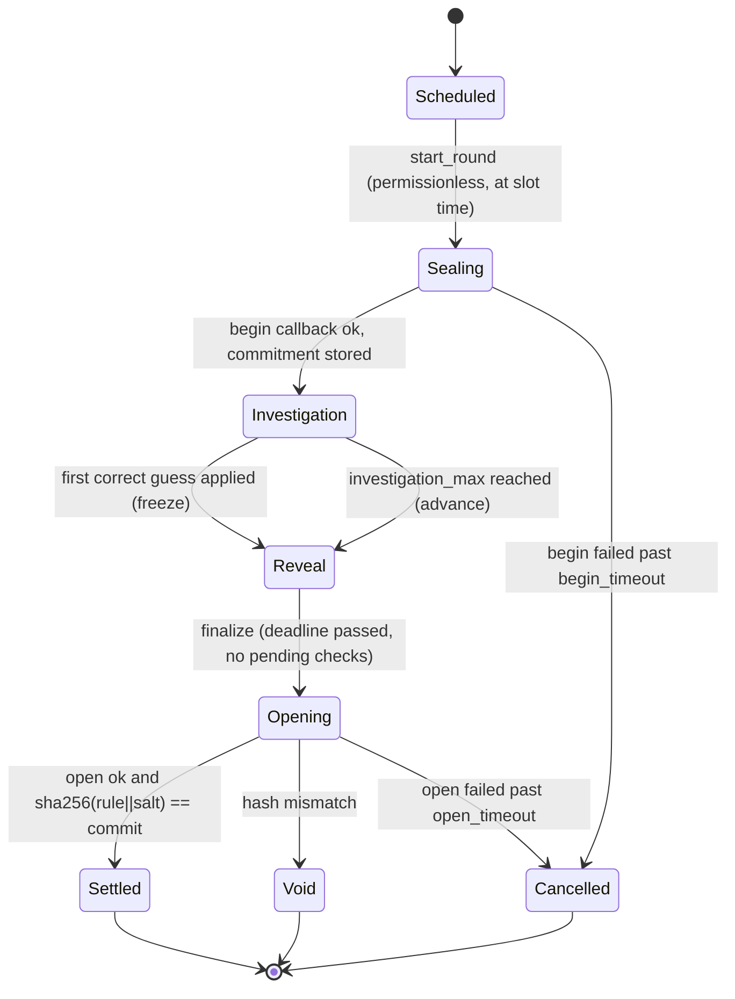

# THE RULE: smart contract specification

This is the protocol contract between the game contract, the token contract, the OutLayer referee, the verifier and every client. Core Solo behavior is locally tested with a mock OutLayer; Phase 0 probe receipts are recorded below. The real game/referee rehearsal and whole-system security review remain open (status 2026-11-05).

## TL;DR and necessity

- Two NEAR testnet contracts. `game` holds all money and game state: play credit, team vaults, pots, stakes, rounds, the public verdict log, payouts and RULE locks. `token` is a plain NEP-141 RULE with one fixed minter (`game`) and a hard supply cap.
- The hidden rule lives only in a hash-pinned OutLayer referee (`enclave/referee`, `wasm32-wasip2`, Intel TDX). The game contract calls it with `request_execution` and accepts only four tiny, strictly parsed answers: `{commit, header}`, `{v}`, `{correct}`, `{rule, salt}`. No answer can name an account or an amount.
- Why on chain [I]: the pot, stakes and payouts need custody nobody can switch off. The play log needs a public append-only order, so "earliest correct commit wins" means chain order and not callback speed. Contracts with no access keys remove the creator's own bypass.
- **Guarantee [I]:** after the key-deletion ceremony, the deployed program does not disclose the rule before the authorized reveal. This holds only under the stated TEE trust model: Intel TDX, OutLayer worker measurements, and the CKD keystore. After the reveal, anyone can check that every verdict matches the revealed rule and the round's commitment.
- **Limit:** the browser replay proves the verdicts were consistent with the revealed rule. It does not prove that the enclave kept the rule secret during the round. A compromised TEE or keystore could leak the rule or bias verdicts. The amounts it could affect are bounded by the formulas below.
- Founder decisions applied here are listed in [OPEN-DECISIONS](../OPEN-DECISIONS.md) D3 to D19. Every number marked "param" is fixed at `new()` and immutable. There are no setters.

## Accounts and authority

| Account (planned, D21) | Holds | Keys after ceremony |
| --- | --- | --- |
| `therule.testnet` | Parent; funds sub-accounts | Founder/lead full-access key (parent cannot control existing children [V](https://docs.near.org/protocol/accounts-contracts/account-id.md)) |
| `game.therule.testnet` | Game contract, all NEAR liabilities | **None.** Every access key is deleted before the first production round (ceremony below) |
| `token.therule.testnet` | RULE NEP-141 | **None.** Deleted in the same ceremony |
| `keeper.therule.testnet` | Pays gas for permissionless transitions | Its own full-access key in the keeper secret store; it holds no authority over the game |
| `platform.therule.testnet` | Receives platform share via `claim_platform` | Founder |
| `demo-game.therule.testnet`, `demo-token.therule.testnet` | Demo Mode instance (D17) | **Keys retained** and labeled not creator-blind |

The game account name is compiled into the referee manifest (`callers.contract.only`). Renaming it means a new referee hash, which means a new key and a new rule stream. Rehearsals use `game-r<N>.therule.testnet` with their own referee build.

## Storage and state machine

### Units and encodings

- NEAR amounts are `u128` yoctoNEAR, serialized as JSON strings. RULE amounts are `u128` with 18 decimals, also JSON strings. Time is `u64` nanoseconds from `env::block_timestamp()`. Basis points (`bps`) are `u16` with 10,000 = 100%.
- State uses Borsh with `near_sdk::store` collections and explicit storage prefixes. Accounts are interned to a `u32` index (`AccountIdx`) to keep log rows small.
- `Mode = Solo | Team` (`u8` 0, 1). `RoundKey = (Mode, round_id: u32)`. `Entity = Solo(AccountIdx) | Team(team_id: u32)`. In Team mode the team, not the member, is the player: one line, one attempt budget, one pending play, one stake.

### Params (set once in `new`, immutable)

| Param | Production default [I] | Demo default [I] | Note |
| --- | --- | --- | --- |
| `play_fee` | 0.01 NEAR | 0.01 NEAR | D3 |
| `fee_split_bps` pot / compute / platform | 8000 / 1500 / 500 | same | D3; 80/10/10 only after T4 data and a new deployment |
| `storage_charge_per_play` | 0.02048 NEAR (2,048-byte lifetime ceiling at the current byte price) | same default; tiny principal-only fixtures are explicitly not collateral proof | Separate non-refundable funding for play/commit/lock records and associated requests, including Team snapshots. Not pot money |
| `storage_charge_account` / `storage_charge_team` | 0.00512 / 0.02048 NEAR (512 / 2,048-byte lifetime ceilings) | same default | First deposit / team creation into `storage_reserve`; production init rejects charges below the byte ceilings at the runtime storage price |
| `stake_bps` solo / team | 100 / 200 | same | D10; of the pot at commit |
| `stake_min` | 0.1 NEAR | 0.1 NEAR | D10 |
| `wrong_return_bps` | 5000 | same | D11; the other half goes to the pot |
| `solved_split_bps` winner / contributors / rollover / platform | 4000 / 4000 / 1000 / 1000 | same | D5 |
| `unsolved_split_bps` contributors / rollover / platform | 4000 / 5000 / 1000 | same | D6 |
| `genesis_ns` | first production slot, after ceremony | any | Round `r` of mode `m` starts at `genesis_ns + r * round_period_ns + mode_offset_ns[m]` |
| `round_period_ns` | 24 h | 15 min | D14 |
| `mode_offset_ns` solo / team | 0 / 12 h | 0 / 0 | Staggers the two daily rounds [I] |
| `investigation_max_ns` | 23 h | 10 min | Investigation ends here if unsolved |
| `reveal_window_ns` | 30 min | 2 min | From freeze or investigation end |
| `begin_timeout_ns` / `open_timeout_ns` | 1 h / 6 h | 5 min / 10 min | Then Cancelled (D7) |
| `min_reveal_delay_blocks` | 2 | 2 | Commit and reveal never share a block |
| `base_attempts` solo / team | 25 / 50 | same | D16; per round |
| `lock_tiers` (RULE locked to extra attempts) | 1,000 to +25; 5,000 to +50; 20,000 to +100 | same | D16; highest tier reached |
| `attempt_cap` solo / team | 125 / 250 | same | Hard cap |
| `share_cap` solo / team | 25 / 50 | same | D8; contributor shares per entity per round |
| `round_allowance` | 500,000 RULE per mode per round | 50,000 | Expires at round end; never pre-minted |
| `mint_base` | 100 RULE | same | Per ACCEPT, scaled below |
| `max_team_size` | 5 | 5 | D15 |
| `referee` | `{outlayer: outlayer.testnet, urls: [primary, mirror], hash, build_target: "wasm32-wasip2"}` | demo referee | All URLs serve identical bytes |
| `resource_limits` per op | begin 10 s, verdict 5 s, guess 30 s, open 10 s; instructions/memory set from T4 | same | Always passed; `None` means compile-only [V](https://raw.githubusercontent.com/out-layer/outlayer/main/contract/src/execution.rs) |
| `outlayer_deposit` per op | `estimate_execution_cost` for those limits plus 20% margin, measured in Phase 0 | same | Paid from the compute float |
| `gas` | OutLayer call 100 Tgas, callback 60 Tgas, token operation 10 Tgas | same | Starting values; measured in P2.9. The verdict callback schedules token `execute_operation` (10) and `on_mint` (10) with a 5 Tgas margin. Below that remaining budget it schedules no mint and keeps the allowance. Permissionless replay separately guards operation + completion + 5 Tgas before scheduling |
| `token`, `platform`, `chain_id` | accounts above, `"testnet"` | demo accounts | |

`new(params, demo: bool)`: `demo` is stored immutably, returned by `get_params` and in every `RoundView`, so the permanent "Demo Mode - preselected rule" label comes from chain data. A production deployment (`demo=false`) requires `genesis_ns >= now + 2 h` (blindness ordering) and production bounds on the schedule (`round_period_ns >= 1 h`, `reveal_window_ns >= 10 min`, begin and open timeouts `>= 10 min`); `demo=true` skips them. Decided 2026-11-04 and tested (1 h 59 m rejected, exactly 2 h accepted, short demo schedule accepted).

**Key-retaining rehearsal exception (D32, authorized 2026-11-06):** `game-r1` may set `demo=true` solely for compressed scheduling while using production economic/storage floors and the published non-demo referee, without `RULE_DEMO`. Its operator label explicitly says compressed rehearsal with no preselected rule; it is not the D17 preselected-rule demo or production-schedule evidence. Product Demo Mode labeling remains required for the separate actual demo instance. Do not infer the referee's build feature or a preselected answer from the schedule flag alone.

Initialization also rejects a mint base above the round allowance, callbacks below 60 Tgas, OutLayer calls below 100 Tgas, token calls below 10 Tgas, or callback-plus-outgoing sums above 250 Tgas (E11). These conservative local bounds leave headroom in a 300 Tgas initiating call; they do not constitute real OutLayer callback measurements or recovery from every possible callback failure. Whole-path gas proof and timeout recovery review remain pre-freeze work.

Root-state size is bounded independently of fee/gas values: `chain_id == "testnet"`, one or two referee URLs of at most 2,048 UTF-8 bytes each, at most three lock tiers, and team size from one to five (E11). At most ten nonterminal rounds may be tracked; starting another rejects E23 before mutation. Completing/cancelling an old round frees capacity, and retrying the same Sealing round consumes no new round slot.

**Operator collateral:** each new round requires unallocated balance for pre-init code/account storage, an 8,192-byte root ceiling, 1,024 bytes per retained round including the new one, and ten 1,024-byte refundable referee-request exposures. `get_ledger.operator_storage_required` quotes the current-round budget; add one 1,024-byte allowance for a new round. `operator_storage_available` subtracts credit, vaults, pots, carry, stakes, claims, compute, platform accrual, pending play debits, pending native payments and player-paid storage reserves from account balance. Shortage rejects E24 before a round/request/debit is created. An ordinary NEAR transfer to the contract funds this unallocated collateral; `deposit_credit`, `seed_pot` and `fund_compute` do not. Budgets grow with retained history, rather than assuming a fixed lifetime round count.

`pending_native_payments` reserves withdrawal/platform principal from scheduling until its matching callback completes. This prevents a failed transfer's returned principal becoming operator collateral before the callback restores credit/accrual. It intentionally double-reserves principal while already escrowed or paid, so admission can reject a financially safe start until the callback completes. A failed, uncompleted callback retains this conservative reservation; the counter is not an authenticated outcome or a recovery mechanism. Do not add it again to the receipt-aware solvency equation, which already accounts for payment exposure separately.

**Referee admission (D27).** The game tracks at most 10 pending begin/verdict/guess/open requests across all modes and retained rounds. New plays and guess reveals require the tracked total to be below 8; begin/open can use the last two admissions, but reject at 10. These fixed pre-freeze limits are returned as `max_pending_referee_requests` and `user_referee_request_limit` by `get_params`; `get_ledger.pending_referee_requests` exposes the current count.

Capacity rejection is E23, after ordinary validation but before credit/compute debits, status changes, sequence allocation, round creation or commit sweeping. It charges no game fee; transaction gas still applies. A settled duplicate still returns its free Known result even at capacity. A rejected reveal leaves its commit Committed and its original reveal deadline unchanged; callers must retry only while the normal deadline permits. There is no on-chain queue or automatic retry.

Each matching referee callback or expiry consumes one request and releases exactly one admission, even on failure or a stale round. Duplicate, late and wrong-kind callbacks cannot release another request's slot. Token/payment requests do not count. Expiry only releases local tracking: an old OutLayer execution may still physically exist, so this is not a provider concurrency/SLA guarantee, a rate limit or a whole-system storage bound.

### Contract state (game)

```text
Game {
  params: Params
  accounts: LookupMap<AccountId, AccountIdx>        // interning, append-only
  players: LookupMap<AccountIdx, Player>            // credit, claimable, team, rule_registered flag
  teams: LookupMap<u32, Team>                       // members (<= 5), invites, vault, lock state
  rounds: LookupMap<RoundKey, Round>
  current: [Option<u32>; 2]                         // active round id per mode
  carry: [u128; 2]                                  // rollover waiting for the next round of that mode
  log: LookupMap<RoundKey, Vector<LogRow>>          // settled verdicts, append-only, paged view
  seen: LookupMap<(RoundKey, u64 play_key), u32>    // play_key -> log index or PENDING
  pending: LookupMap<u64 request_id, Request>       // in-flight OutLayer calls
  pending_referee_requests: u32                     // O(1) admission count, excludes token/payment
  pending_native_payments: u128                      // conservative operator-admission reservation
  commits: LookupMap<(RoundKey, u32 commit_seq), Commit>
  entity_round: LookupMap<(RoundKey, Entity), EntityRound> // attempts, shares, line, pending flag, locks
  seasons: LookupMap<(Mode, u32 season), SeasonBoard>
  compute_float: u128, platform_accrued: u128, storage_reserve: u128
  next_request_id: u64, next_seq: u64                // global contract sequence for plays and commits
}

Round { phase, seed: [u8;32], commit: [u8;32], header: RoundHeader, pot: u128,
        allowance_left: u128, minted: u128, best: Option<(commit_seq, Entity)>,
        freeze_ns: Option<u64>, reveal_deadline_ns: u64, pending_checks: u32,
        total_shares: u64, outcome: Option<Outcome>, rule: Option<CanonicalRule>, salt: Option<[u8;32]> }
LogRow { log_idx: u32, seq: u64, entity: Entity, actor: AccountIdx, play: Play, verdict: bool, minted: u128 }
Commit { seq: u64, entity: Entity, actor: AccountIdx, hash: [u8;32], stake: u128, block: u64, status: Committed|Checking|Correct|Wrong|Refunded|Unrevealed }
```

`Play` and `play_key` are defined by `rule-core` (Encodings). A `LogRow` holds every field the verdict depends on, so replay needs only the log, the rule and the salt.

### Round phases



- **Investigation:** plays and new commits are accepted. Reveals of existing commits are also accepted, so a confident player can end the round early.
- **Freeze:** when the first `correct: true` guess result is applied, the round moves to Reveal at once. New plays and new commits are rejected. Plays still in flight are refunded with no mint and no share. Existing commits may reveal until `reveal_deadline_ns = freeze_ns + reveal_window_ns`.
- **Winner:** the Correct commit with the smallest `seq`, never the first callback. A later Correct commit gets its stake back but no win.
- **Outcome:** `Solved{winner}` if any commit is Correct at finalize, otherwise `Unsolved`. Payouts become claimable only in Settled, after the hash check. This is "proof before money".
- **Next round:** the next round of a mode cannot start before its slot time and before the previous round of that mode has left Investigation and Reveal. One round per day per mode; a solved round leaves the rest of its day empty.

## Public interfaces

`[fck]` means callable with a function-call access key (no deposit). `1y` means exactly 1 yoctoNEAR must be attached, which forces a full-access key because function-call keys cannot attach deposits ([V](https://docs.near.org/protocol/accounts-contracts/access-keys.md)). Panics use stable codes `E<nn>` (table below). Every mutating method checks, in order: phase, caller authority, input bounds, balances; then it writes state, then makes external calls.

### Credit, teams, locks

| Method | Caller | Effect |
| --- | --- | --- |
| `deposit_credit()` payable | anyone | Adds the deposit to the caller's credit. The first deposit interns the account and charges `storage_charge_account` |
| `withdraw_credit(amount)` `1y` | owner | Pays credit out. Rejected while the caller has a pending play or a Checking guess (E21) |
| `create_team(name)` | deposited player not in a team | Charges `storage_charge_team` from personal credit; caller becomes captain; `name` is 3 to 24 ASCII chars `[a-z0-9-]` |
| `invite(account)` / `join_team(team_id)` / `leave_team()` / `remove_member(account)` | captain / invitee / member / captain | Members plus outstanding invites never exceed `max_team_size`; the captain can revoke invites. Roster changes require no active unsettled participation (E30). Departure/removal first credits that depositor's pro-rata vault principal; captaincy passes to the first remaining member and the last departure removes the empty team |
| `team_deposit(team_id)` payable | member | Adds the entire deposit to vault and depositor weight, only while unlocked and `vault == total_weight`. After play losses, all old positions must first withdraw to credit before a new deposit epoch; nominal new weights must not subsidize old losses. At most five depositor records |
| `team_withdraw(team_id)` `1y` | depositor | While unlocked, credits `v = floor(vault * w_i / W)` to personal game credit, removes weight `w_i`, and reduces vault by `v`. Native transfer is a separate `withdraw_credit`. Reducing `W` by the payout would be wrong after losses; the old ambiguous wording is superseded |
| `settle_team(team_id)` | anyone | Once the participating round is terminal and its play has completed/refunded, returns refundable pot contribution and Correct stakes to the vault exactly once, then releases the participation lock. Rewards remain separate per-member claims |
| `claim_team(mode, round_id, team_id)` | member of the stored round snapshot | Credits that historical member's equal winner/contributor payout once. Works after leaving or deleting the current roster; `claim(Team, round_id)` resolves current membership only |
| `register_token()` | any depositor | Calls token `storage_balance_of(account)` with zero attached NEAR and never debits credit. Players first pay the standard NEP-145 storage deposit directly to the token. A valid non-null `{total, available}` response marks Registered; malformed/null/failed responses reset None. Pending checks reject E57; completed checks may be refreshed. A stalled read-only check can be expired after ten minutes, resetting None so the player can retry; late responses cannot overwrite the replacement. Until confirmed, ACCEPT mints nothing and consumes no allowance (D29) |
| `ft_on_transfer(sender, amount, msg)` | `token` only (E40) | `msg = {"lock":{"mode":0,"round_id":r}}` locks RULE for the sealing or next round. Each new `(mode, round, account)` lock requires a game player and debits `storage_charge_per_play` from personal credit; top-ups reuse their entry. Insufficient credit, malformed/zero input or wrong round returns all tokens without accepting the lock. Team locks require membership; attempt tiers sum the current locked roster's member-owned entries. Every locker retains their own return right |
| `unlock(mode, round_id)` `1y` | locker | After a terminal round, or one full period after the slot of a never-started round: reserves/removes the lock and sends a uniquely identified token `execute_operation` of kind `unlock`. Applied completion releases it; authenticated terminal rejection restores it once. Unknown transport leaves a permissionlessly replayable pending operation. The user's one yocto remains in the game; the fixed-minter token call attaches zero |
| `get_token_operation(request_id)` | anyone, view | Returns the immutable pending mint/unlock payload, or `null` for consumed/other request kinds |
| `retry_token_operation(request_id)` `[fck]` | anyone | Resends that exact id/payload to the configured token, with no fresh id, credit debit or native deposit. No timeout is needed. Overlapping retries are safe because the token retains its outcome. E50 rejects absent/wrong-kind requests or insufficient scheduling gas |

The withdrawal guard counts every Checking guess belonging to the player, independently of the pending play/withdrawal flag. One completed or duplicate callback cannot release another live check. Correct, wrong and system-failure outcomes each release only their own check. The player record stores this count as a `u32`; storage measurements must include it.

A team snapshots at most five members on its first accepted play/commit. A fully refunded first play removes a provisional snapshot if no paid commit or other entitlement owns it; otherwise the roster stays locked. A team cannot participate in the next round until its prior terminal vault principal is settled; other teams and Solo rounds remain independent. Deposits and withdrawals cannot race unresolved vault losses/refunds. Per-round member claim bits preserve historical reward rights. Exact contributor split dust is tracked by fifteen bounded counters for roster size and `shares mod size`, without scanning all entities.

### Plays

`play(mode, number: u16, word: String) -> PlayAck` `[fck]`

1. Round of `mode` is in Investigation (E10). Caller's entity is resolved: Solo is the caller; Team is the caller's team (E32 if none).
2. `number <= 999`; `word` is normalized (trim ASCII whitespace, ASCII lowercase) and must be in the published 128-word list (E11). Normalization is part of `rule-core` grammar `g1`.
3. Build `Play{number, word_id, minute_digit, prev}` from the block timestamp and the entity's line (its last ACCEPT this round), then compute `play_key`.
4. **Duplicate:** if `seen` has `play_key` with a settled verdict, return `PlayAck::Known{verdict, log_idx}`. No fee, no state change, no enclave call, no mint, no share, no log row (D9). If it is PENDING, panic E12 (nothing charged).
5. Entity has no pending play (E13) and attempts used < attempt limit (E14).
6. Debit `play_fee + storage_charge_per_play` from the payer: the caller's credit (Solo) or the team vault (Team). Insufficient: E20. `compute_float` must cover `outlayer_deposit.verdict` (E22, play rejected rather than borrowing from the pot).
7. Assign `seq`, mark `seen[play_key] = PENDING`, store `Request{Verdict, round, entity, actor, play, seq}`, increment attempts, set entity pending.
8. Call `outlayer.request_execution(...)` with the `verdict` input, then `.then(on_verdict(request_id))`. Return `PlayAck::Pending{request_id, seq}`.

`on_verdict(request_id)` `#[private]`, never panics after loading the request:

- Parse the promise result strictly as `{"v":0|1}`. Anything else, JSON `null` (OutLayer's failure encoding [V](https://raw.githubusercontent.com/out-layer/outlayer/main/contract/src/execution.rs)), a promise error, a wrong round, or a round that has left Investigation leads to **refund**: credit back fee + storage charge, attempt restored, `seen` entry removed, pending cleared, event `play_refunded{reason}`.
- Refund cleanup removes an otherwise empty entity only if it has no open/correct commits, pot contribution or prior claim. A play and a guess may overlap; restoring a play attempt must not erase another operation's stake, refund entitlement or three-open-commit limit.
- On a valid verdict: pot += 80% of fee, compute_float += 15%, platform_accrued += 5%. Append the `LogRow`. Set `seen[play_key] = log_idx`. Shares += 1 if under `share_cap`, and `total_shares` += 1 likewise. If ACCEPT, advance the line and mint (below). Clear pending. Event `play_settled`.
- Mint on ACCEPT: `m = mint_base * allowance_left / round_allowance * bucket_bps / 10_000` (exact integer math with a 128-bit mul-div), with bucket 10000 Rare, 5000 Mid, 2500 Common. Initialization rejects `mint_base > round_allowance`; the result is capped at remaining allowance. For a Registered player and positive `m`, reserve allowance and log `minted = m`, then send token `execute_operation` of kind `mint` using the immutable game request id and original actor. Only a matching terminal rejection restores allowance and zeros the row (`mint_failed`); the YES stands. Unknown transport retains the reservation, including after settlement or a later round starts. Pending intended mint amounts are not confirmed supply. Direct user-paid NEP-145 registration and the game's zero-deposit check remain separate (D29).

### Authenticated RULE operation outcomes

`crates/protocol/src/token.rs` defines strict wire schemas. `TokenOperation` contains `operation_id: u64`, `kind: mint|unlock`, `account_id` and canonical decimal-string `amount`. `TokenOutcome` returns that entire operation plus `status: applied|receiver_unregistered|insufficient_balance|cap_exceeded|invalid_amount`. Both objects reject unknown/duplicate fields. A game callback reads at most 1,024 bytes and accepts only an exact id/kind/recipient/amount match and a status valid for that kind. Failed, oversized, malformed, null or mismatched results leave pending state untouched. The callback consumes a matching terminal result once; duplicates and late responses cannot mutate a replacement.

| Token method | Authority and semantics |
| --- | --- |
| `execute_operation(operation)` | Immutable minter only, zero deposit. Atomically applies the mint or minter-custody unlock and retains a terminal outcome. Expected balance, registration, cap and zero-amount failures are recorded rejections, not failed receipts. Exact replay returns the original outcome without changing supply, balances, funding or events. Conflicting payload under the same id rejects E11; unauthorized calls reject E54 before lookup |
| `get_operation(operation_id)` | Public historical outcome view; absence is not proof that an in-flight call failed |
| `fund_operations()` payable | Anyone may contribute positive, **nonrefundable** NEAR to the dedicated retained-outcome budget. No withdrawal/admin path. This is separate from NEP-145 registration, game storage charges, compute and game operator collateral |
| `get_operation_funding()` | Returns available budget, live cost per new terminal outcome and completed count |

Each new outcome, including a business rejection, consumes `256 * storage_byte_cost` from the dedicated budget. At the current byte price this is 0.00256 NEAR; deployment must obtain the live quote and explicitly fund the expected lifetime operation count. Insufficient funding rejects E24 **before effects or allocation**; the game request remains pending and can replay after a contribution. Token account surplus and registration deposits never implicitly refill this budget. Root/code collateral remains separately operator-funded. Records are retained permanently to fence arbitrarily delayed original/replayed calls; storage grows only with funded new operations and each lookup is O(1). This is funded lifetime growth, not bounded total history or free unlimited operator subsidy.

The old token `mint` export is removed; ordinary NEP-141 transfer APIs remain standard. Token registration for the fixed minter cannot be unregistered, preserving custody. A failed callback is recovered by resending the same token operation, not by trusting a caller-supplied outcome, current token balance or elapsed time. Successful callback execution still depends on NEAR runtime availability; permissionless replay removes the single-callback liveness dependency, not the chain dependency.

This pre-freeze cutover changes game/token Borsh layouts and targets **freshly initialized rehearsal contracts**. It includes no state migration, old-ABI compatibility layer or upgrade path for keyless production accounts. Real game/token deployment remains unexercised; rebuilding the old layout is not a migration strategy.

**Local recovery proof (2026-11-06):** actual game/token WASM with MOCK OutLayer passed `token-recovery`. An empty outcome budget produced E24 before minting; explicit funding plus two overlapping third-party replays applied one mint and one storage charge. Masking only the game's `on_mint`/`on_unlock` export names caused real `MethodNotFound` callback failures after successful token effects. Restoring the original local artifact and replaying the same ids reconciled once, preserved a later paid replacement lock, and kept supply/custody/funding exact. A recorded registration rejection stayed rejected after re-registration, Void and the next round; its old allowance/log restoration occurred once.

The export masking and redeployment are **sandbox-only fault injection on a key-retaining account**, not a production upgrade or recovery requirement, gas-starvation proof, universal scheduler guarantee or testnet evidence. Ordinary failure/re-registration, maximum-root callback, multi-round, five-member Team, retained-storage, historical native-payment balance and settlement-sweep executables also passed in the same completed command. Evidence: `scratch/recovery-runtime.log`. Native NEAR payment recovery remains the boundary below.

### Guesses

`commit_guess(mode, hash: hex[32]) -> CommitAck{commit_seq, seq, stake, block}` `[fck]`

- Investigation only (E10). Entity has fewer than 3 open commits this round (E15) [I].
- Stake = `max(stake_min, pot * stake_bps[mode] / 10_000)` from the current pot, debited now from credit or vault (E20). Stored with `seq` and `block`. The stake is fixed at commit and never recomputed. [I] Each commit record also pays `storage_charge_per_play` into `storage_reserve`, never refunded (the record stays on chain even when the stake is refunded). Commit-record lifecycle events: `guess_checked{mode, round_id, commit_seq, result: correct|wrong|refunded}`.

`reveal_guess(mode, commit_seq, guess: hex, salt: hex[32]) -> request_id` `[fck]`

- Round is in Investigation or Reveal and before `reveal_deadline_ns` (E16). Caller is the commit's `actor` (E17). Commit status is Committed and `block_height >= commit.block + min_reveal_delay_blocks` (E18).
- `sha256(commit_preimage(...)) == hash` (E19). `guess` parses and fits the round's tier (E11). Otherwise the reveal panics and the commit stays Committed; it can still be revealed correctly before the deadline.
- Status becomes Checking, `pending_checks += 1`, call referee `guess`, then `.then(on_guess(request_id))`. `advance` at `investigation_max` also sets `freeze_ns`, so `freeze_ns` marks the start of Reveal however it began; a later Correct callback never moves it or the deadline.

`on_guess`: `{"correct":true}` sets Correct. If no freeze yet, freeze now. `best` = min(best, seq). `{"correct":false}` sets Wrong: 50% of the stake goes to the payer's claimable balance (Solo credit, Team vault) and 50% to the pot. Any failure sets **Refunded**: the full stake returns and the commit may not be revealed again (D7). `pending_checks -= 1`. There is no counterexample, ever (D11).

### Round lifecycle (permissionless; the keeper calls them, anyone may)

| Method | Precondition | Effect |
| --- | --- | --- |
| `start_round(mode)` | Slot time reached, previous round of mode out of Investigation/Reveal, no round Sealing | Creates the round, `seed = env::random_seed()`, moves `carry[mode]` into the pot, `allowance_left = round_allowance`, calls referee `begin`. A retry is allowed if a begin request failed and `begin_timeout` has not passed |
| `advance(mode)` | Investigation and `now >= investigation_end_ns` (`begin_ok_ns + investigation_max_ns`) | Moves to Reveal with `reveal_deadline = now + reveal_window` |
| `finalize(mode) -> Option<request_id>` | Reveal, `now >= reveal_deadline`, `pending_checks == 0`, compute float covers the `open` deposit (E22) | Sweeps at most 20 commits per call: every commit still Committed becomes Unrevealed and is treated as Wrong (50/50, D12). While commits remain it returns `None` and the keeper calls again; on the last batch it computes `outcome` (`Solved{winner}` if any commit is Correct, by smallest `seq`), moves to Opening and calls referee `open` (returns its request id) |
| `retry_open(mode, round_id) -> request_id` | Opening, last open failed, before `open_timeout` | Calls `open` again |
| `cancel(mode, round_id)` | Sealing past `begin_timeout` (no begin pending), or Opening with a failed open past `open_timeout` | Cancelled refund path (below) |
| `expire_request(request_id) -> bool` | Pending referee or read-only token registration request at least 10 minutes old (E50 before that deadline) | Applies the normal failure cleanup exactly once: begin clears pending and may cancel, verdict refunds fee/storage and restores attempt, guess refunds the full stake and clears both Checking counters, open becomes failed, registration resets None without moving money. Returns false for absent/completed requests or withdraw/platform/mint/unlock. No external call |
| `claim(mode, round_id) -> amount` | Settled, Cancelled or Void; caller's entity not yet claimed (E56 otherwise) | Credits the caller's owed amounts to their credit: payout (Settled) or pot contribution (Cancelled, Void), plus the stakes of the entity's Correct commits. One `claimed` flag per entity and round makes it idempotent. Team vault items follow in P4 |
| `claim_platform() -> request_id` | anyone; `platform_accrued > 0` (E56) | Transfers `platform_accrued` to `platform`; a failed transfer restores it in `on_platform` |
| `seed_pot(mode)` payable | anyone | Adds to `carry[mode]` (sponsor seed) |
| `fund_compute()` payable | anyone | Adds to `compute_float` (sponsor top-up; never withdrawable, never pot money) |

`on_open`: strict `{"rule":CanonicalRule,"salt":hex32}`. If `sha256(canonical_bytes(rule) || salt) == round.commit`: store both, phase Settled, compute payouts (formulas below), update the season board. A mismatch sets Void and emits `round_void`. A failure sets `open_status = failed` and keeps Opening, so `retry_open` (or, past the timeout, `cancel`) is possible. A stale or duplicate callback is a no-op. `get_claimable(mode, round_id, account)` returns what `claim` would credit now.

Every begin/verdict/guess/open and read-only token registration request stores `expires_at_ns = initiation_timestamp + 600_000_000_000` (saturating `u64`). If its callback never finishes, anyone with the request id from the initiating receipt can call `expire_request`; no key or owner privilege is required. Recovery consumes that exact id before the shared failure handler completes. A later callback is a no-op and cannot affect a replacement request. If a valid callback executes first, expiry returns false, including at or after the deadline. The ten-minute policy remains independent of round retry/cancel timeouts. Registration expiry changes no referee admission count.

Expiry never restores compute already spent at OutLayer. Withdraw/platform payments remain ineligible: unknown native transfers cannot safely be refunded or resent. Mint/unlock use authenticated idempotent replay above, not timeout restoration. Registration remains a zero-deposit read whose expiry resets confirmation without changing token storage or money.

**Local recovery evidence (2026-11-05):** five native recovery tests passed for the exact ten-minute boundary, permissionless refund, duplicate/late callback fencing, callback-versus-expiry ordering, begin retry/cancel, guess refund/finalization and open retry/cancel; transfer requests remain ineligible. A throwaway sandbox smoke deliberately bypassed init validation to allocate only 1 Tgas to a verdict callback, observed a stranded pending play and E50 before expiry, then patched only that request's deadline to exercise recovery. Full credit/attempts returned once and withdrawal succeeded. The smoke did not wait ten real minutes; the exact clock boundary was covered natively. Its fault-injection source was removed after the run. Zero gas was unsuitable fault injection: the sandbox rejected the initiating receipt with `FunctionCallZeroAttachedGas`, rather than stranding a callback.

**Read-only registration recovery (2026-11-05, locally exercised):** two new native regressions failed before the change and passed afterward. They cover E50 just before the deadline, third-party expiry exactly at it, unchanged credit/obligations/referee count, callback-first ordering, refresh expiry, and old success/failure responses arriving around a replacement. Until a new check confirms registration, a YES mints zero and preserves allowance.

A throwaway sandbox executable deliberately patched callback gas from the validated 60 Tgas to 1 Tgas, observed an actual `on_register` receipt fail with `Exceeded the prepaid gas.`, and observed Pending plus E50. Patching only that request's deadline then allowed a third party to expire it once. Restoring normal gas and retrying confirmed Registered with unchanged game credit. The executable was removed; logs are in `scratch/register-recovery-runtime.log`. This is explicit fault injection, not ten elapsed minutes, production configuration or testnet evidence. The added deadline changes request serialization; prior committed artifact hashes remain historical and must not be used for this source revision.

All callback finishers check the expected request kind before removal. A misrouted private callback must leave another operation's request and obligations intact; this is dispatch hardening, not a claim that an external caller can invoke private callbacks.

`cargo test -p game --test callback_fences --profile fast` passed two native matrices: every wrong dispatcher against live verdict/guess requests followed by success/failure/expiry, and every wrong dispatcher against withdraw/platform/register/mint/unlock followed by success/failure and a replacement. Exact credit, stake/allowance/lock restoration, token state and referee admission were checked after duplicates and late responses. A failing-before withdrawal dispatcher reproduced a consumed request with stuck admission or missing restoration. These native checks deliberately exclude the mocked VM balance, which resets between simulated receipts; actual balance/escrow proof is the separate sandbox reporter.

### Views (paged, read at `final`)

`get_params()`, `get_round(mode, id?)`, `get_log(mode, id, from_idx, limit<=200)`, `get_verdict(mode, id, play)` (duplicate pre-check for the UI), `get_entity(mode, id, account)` (attempts, limit, shares, line, pending), `get_commits(mode, id, from, limit)`, `get_player(account)`, `get_team(id)`, `get_claimable(mode, id, account)`, `get_season(mode, season, from, limit)`, `get_ledger()` (all invariant terms), `get_word_list()`.

**`RoundView` fields (decided 2026-11-04, so the keeper, verifier and web read one shape).** `mode`, `round_id`, `phase`, `slot_ns` (`genesis_ns + round_id * round_period_ns + mode_offset_ns[mode]`), `sealing_started_ns` (when `start_round` was applied; the origin of `begin_timeout_ns`), `begin_status` (`none | pending | failed | ok`), `investigation_end_ns` (`begin_ok_ns + investigation_max_ns`, set when `begin` succeeds), `freeze_ns`, `reveal_deadline_ns`, `pending_checks`, `opening_started_ns` (when `finalize` was applied; the origin of `open_timeout_ns`), `open_status` (`none | pending | failed | ok`), `commit` (hex32), `header`, `pot`, `log_len`, `outcome`, and, only after Settled, `rule` and `salt`. `begin_status`/`open_status` become `failed` when the OutLayer callback reports a failure and a retry is allowed until the timeout.

**Keeper views.** `get_params()` also returns `genesis_ns`, `round_period_ns`, `mode_offset_ns`, `investigation_max_ns`, `reveal_window_ns`, `begin_timeout_ns`, `open_timeout_ns`. `get_active_rounds()` returns every non-terminal round of both modes (at most a few, because a mode starts its next round only after the previous one left Investigation and Reveal, while an Opening round may overlap the next Sealing or Investigation round). `get_next_slot(mode)` returns `{round_id, slot_ns}` of the next round that `start_round` would accept. Missed slots: `start_round` is accepted at any time at or after `slot_ns` while the mode has no round in Scheduled to Reveal; the round's deadlines run from the actual `begin` success, never from the missed slot.

### Panic codes

| Code | Meaning | Code | Meaning |
| --- | --- | --- | --- |
| E10 | Wrong round phase for this call | E21 | Withdraw while a play or guess check is pending |
| E11 | Invalid input (number, word, rule, tier) | E22 | Compute float cannot cover the referee deposit |
| E12 | Same combination is pending | E30 | Team roster is locked for a round |
| E13 | Entity already has a pending play | E31 | Team is full (5) |
| E14 | Attempt limit reached | E32 | Caller is not in a team (Team mode) |
| E15 | Too many open commits (3) | E33 | Caller is not the captain / not invited |
| E16 | Reveal deadline passed | E40 | `ft_on_transfer` not from `token` |
| E17 | Caller is not the commit's actor | E41 | Lock target round is not Scheduled |
| E18 | Reveal in fewer than 2 blocks after commit | E50 | Lifecycle transition not due yet |
| E19 | Commit preimage does not match | E51 | Exactly 1 yoctoNEAR required |
| E20 | Insufficient credit or vault balance | E52 | Token: mint receiver is not registered |
| E53 | Token: `storage_unregister(force=true)` rejected | E54 | Token: caller is not the minter |
| E55 | Token: mint would exceed the cap | E56 | Nothing to claim (already claimed, no entry, or nothing owed) |
| E57 | Token registration check already pending | E23 | Referee admission capacity reached; nothing charged |
| E24 | Unallocated operator storage collateral is insufficient; no game funds borrowed | | |

### Payout formulas (exact integer arithmetic)

Let `P` be the round pot at finalize: rolled-in carry + sponsor seed + 80% of settled play fees + 50% of wrong or unrevealed stakes. Write `f(x, bps) = x * bps / 10_000` (floor).

- **Solved:** `W = f(P,4000)`, `C = f(P,4000)`, `R = f(P,1000)`, `L = f(P,1000)`.
- **Unsolved:** `W = 0`, `C = f(P,4000)`, `R = f(P,5000)`, `L = f(P,1000)`. If `total_shares == 0`, then `R += C` and `C = 0` (D6; never to platform).
- Per share `c = C / total_shares` (floor). An entity with `s` shares receives `s * c`. Team shares split equally among locked members: `s * c / k` each.
- The winner entity receives `W`. A winning team splits `W / k` equally among its `k` members, with no vote. The winner's stake is returned separately and is never part of `W`.
- **Dust:** `D = P - W - L - R - c*total_shares - (team split remainders)`, and `R += D`. Then `carry[mode] += R` and `platform_accrued += L`.
- **Invariant I2 per round:** `P == W + C_paid + R_final + L`, exactly. Stakes are a separate ledger: each stake is fully accounted as returned, returned + to-pot, or refunded.

### Cancelled and Void (D7)

Stakes are refunded in full: a wrong or unrevealed stake already returned its share at once, and the half that went to the pot is part of the entity's `pot_contribution`; Correct stakes return on `claim`. The round pot minus rolled-in carry and sponsor seed (`base_pot`) is refunded to the entities that paid it: each entity's `pot_contribution` is 80% of its settled fees plus the pot halves of its wrong or unrevealed stakes, exactly, because the ledger records it per entity. Carry and seed go back to `carry[mode]`. Locked RULE is unlockable. Compute and platform shares already earned on delivered verdicts are not refunded, because the service was delivered. Mints already made stand. Void additionally emits `round_void{expected, got}` as public evidence of an enclave fault.

### Season board

Seven consecutive rounds per mode form a season (`season = round_id / 7`). Per entity: rounds won, contributor shares, NEAR earned. Order [I]: rounds won desc, then shares desc, then earliest winning block asc. Best Individual is the Solo board; Best Team is the Team board.

## Encodings and invariants

All byte layouts live in `crates/rule-core` (grammar) and `crates/protocol` (wire types). Contract, referee, verifier CLI and browser import them. Golden vectors in `tests/vectors/` are checked by every target (T-ENC).

- **Play key** `u64`: bits `number(10) | word_id(7) | minute_digit(4) | has_prev(1) | prev_number(10) | prev_word(7) | gap_bucket(2)`, zero-padded. `minute_digit` = minute-of-hour mod 10, from the play receipt's block timestamp. `gap_bucket` is time since the entity's last ACCEPT: <1 min, <1 h, <24 h. Grammar `g1` daily tier reads only these fields (D18).
- **Canonical rule bytes:** `"g1" | form u8 | n u8 | n x (atom_id u8, negated u8)`, with literals sorted by `(atom_id, negated)`. Form codes: `0` single literal, `1` AND, `2` OR. Parsing rejects unsorted, duplicate or out-of-tier input. JSON form for humans: `{"v":"g1","form":..,"lits":[[id,neg],..]}`. Atom ids follow the catalog order in sources/28 section 1.2; the daily tier uses ids 0 to 89 and excludes gap bucket 3 (D18). The authoritative list is `crates/rule-core/src/atoms.rs` (P1.1, 2026-11-04, locally tested).
- **Round commitment:** `sha256(canonical_rule_bytes || salt32)`.
- **Guess commit preimage:** `sha256("the-rule/commit/v1" || len-prefixed(chain_id) || len-prefixed(game_account) || mode u8 || round_id u32 LE || len-prefixed(actor) || entity tag+id || canonical_guess_bytes || salt32)`. It is bound to the actor, so a copied reveal fails E17/E19.
- **Referee input** (stdin JSON, `crates/protocol::RefereeRequest`): `{"op":"begin"|"verdict"|"guess"|"open","g":"g1","chain":"testnet","game":"<account>","mode":0,"round":N,"seed":"hex32","commit":"hex32|null","play":{..}?,"guess":"hex|null"}`.
- **Referee derivation (inside the TEE):** `ctx = "the-rule/v1" || u32le(len(chain)) || chain || u32le(len(game)) || game || mode u8 || round u32 LE || seed32` (`protocol::referee_context`). `k = mac("rule", None, ctx)` through `outlayer:encryption-keys/api.mac` [V](https://raw.githubusercontent.com/out-layer/outlayer/main/worker/wit/deps/encryption-keys.wit). The rule is `sample(k || "rule")`, the salt is `mac("rule", None, "salt" || ctx)`, the commitment is `sha256(canonical_rule || salt)`. `header.grammar` is `protocol::grammar_hash()`: sha256 over `"the-rule/grammar/g1/daily\n"`, every word of the word list in id order each followed by `"\n"`, then the 90 atom ids as bytes. Every op except `begin` recomputes the commitment and aborts with no output if it differs from the input `commit`. Sampler contract: SHA-256 counter-mode DRBG documented in `crates/rule-core/src/sample.rs` (decided 2026-11-04).
- **Referee output:** exactly one of `{"commit":"hex32","header":{"tier":"daily","bucket":"rare|mid|common","grammar":"hex32"}}`, `{"v":0|1}`, `{"correct":true|false}`, `{"rule":{..},"salt":"hex32"}`. Unknown fields are rejected. Output is fixed-shape and short; there are no secret-dependent error strings. Log order: `get_log` returns rows in **apply order** (the order verdict callbacks were applied), each with its issue `seq`; `seq` is unique but not monotone in the log, so the verifier checks contiguous indexes, unique `seq`, and verdict equality, never seq order.

| Id | Invariant | Enforced by | Test |
| --- | --- | --- | --- |
| I1 | At quiescence, `balance >= Σcredit + Σvault + Σround pots + Σcarry + Σopen stakes + Σclaimable + compute_float + platform_accrued + max(storage_reserve, locked_storage)` | `storage_reserve` already backs collateral. `pending_credit` holds unsettled play fee/storage debits, not outgoing transfers | 10k native Solo principal sequences and sampled same-block sandbox snapshots pass; actual unknown-outcome payment reconciliation and worst-case reserves remain B6 |
| I2 | Per round `P == W + C_paid + R + L` (or the exact refund sum when Cancelled) | Payout code, dust to R | T-INV-2 |
| I3 | After all mint requests reconcile, `token.ft_total_supply == Σ minted on LogRows − Σ burned <= cap`; pending rows contain reserved intended amounts, not proof of confirmed issuance. The only burn is the standard NEP-141 resolver burn when a refund target unregistered; each round reserves at most its allowance | Durable token outcome + exact game acknowledgement; replay never applies a second effect | T-INV-3 sandbox, T-TOK-3 |
| I4 | Referee output cannot name an account or an amount | Strict schema parse | T-REF-4 fuzz the parsers |
| I5 | Winner = min `seq` among Correct commits | `best` update in `on_guess` | T-GUESS-3 out-of-order callbacks |
| I6 | Each `request_id` is applied at most once; pending stale-round results refund, consumed ids are no-ops | `pending.remove` first in shared callback/expiry handlers | T-CB-2 duplicate/late callback and expiry races |
| I7 | No method deploys code, adds or deletes keys, deletes the account, or makes caller-chosen external calls. Allowed outgoing calls: OutLayer requests, token calls, `ft_transfer_call` receiver calls and NEP-145 storage refunds to the predecessor | ABI review + `T-ABI-1` pins the method list | T-ABI-1 |
| I8 | `ft_transfer`/`ft_transfer_call` never read game state or the rule | Token has no hook | T-TOK-2 transfer during an open round |
| I9 | No play or commit is accepted after freeze; in-flight plays at freeze refund with no mint and no share | Phase checks | T-FREEZE-1 |
| I10 | A duplicate play changes no state and charges nothing | Step 4 of `play` | T-PLAY-4 |
| I11 | Locked RULE is always returnable; never forfeited | `unlock` | T-LOCK-2 |
| I12 | Team: winner and share payouts split equally; vault refunds pro rata | Payout + `team_withdraw` math | T-TEAM-3 property |
| I13 | Nothing is claimable before Settled with the hash check, except Cancelled/Void refunds | `claim` phase check | T-OPEN-2 |

## Security and upgrade authority

**Key-deletion ceremony (blindness ordering, sources/28 section 0.2):**

1. Freeze contract code and the referee build. Publish the referee bytes at the primary and mirror URLs. Record `sha256` and the reproducible-build recipe.
2. Deploy `token` (`new(minter=game, cap, metadata)`) and `game` (`new(params)` with `genesis_ns` at least 2 h in the future).
3. Delete every access key of `game` and `token`. Record the deletion transaction hashes and blocks.
4. Publish `view_access_key_list` for both accounts (empty) at a block before the first `start_round`. The first seed is `env::random_seed()` of a block after deletion, which was unpredictable at deletion time. A creator who queried the referee as `game` before deletion therefore learned nothing about any real round.

**Bypass analysis [I]:**

| Path | Why it fails |
| --- | --- |
| Creator calls OutLayer directly with the referee | `callers.contract.only = [game]` rejects; under `caller:"predecessor"` another account would derive a different key anyway |
| Creator rebuilds the referee | A new hash means a new `bind:"wasm"` key, so a different rule stream. The game pins the old hash |
| Creator upgrades the game | No keys and no self-deploy method (I7) |
| Referee secret input | The production referee has no secret or env input path. The demo-only `RULE_DEMO` secret exists only behind the `demo` cargo feature, which changes the hash; CI asserts the production hash |
| Leak through output shape | Fixed-shape outputs; no counterexamples; errors produce no stdout. Timing and instruction side channels are residual [U] |
| Validator or keeper ordering | Keepers cannot choose seeds, winners or amounts. A block producer can see the seed but not the MAC key |
| Fast callback steals the win | The winner is decided by commit `seq` (I5) |
| Referee lies under a compromised TEE | Verdict bias is bounded by the allowance and pot formulas, and detectable at reveal for verdicts. A leaked rule is not detectable. Residual risk, stated in the PRD |
| Manifest egress | No `connector_id`, so egress is not fail-closed by default [V](https://raw.githubusercontent.com/out-layer/outlayer/main/wasi-examples/CONNECTOR_MANIFEST.md). The referee imports no network interface; P2.3 checks the component's imports list |

**Residual trust:** Intel TDX and its TCB, OutLayer's admin-approved worker measurements, the DAO-gated CKD keystore master, NEAR MPC, and OutLayer liveness. A total OutLayer outage leads to the Cancelled refund path, never an unrevealable locked pot.

## Compiler, target and dependencies

| Item | Version | Source, observed 2026-11-04 |
| --- | --- | --- |
| near-sdk, near-contract-standards | 5.30.0 (MSRV 1.95, min protocol 88) | [crates.io](https://crates.io/api/v1/crates/near-sdk) [V] |
| cargo-near | 0.22.0; reproducible image `sourcescan/cargo-near:0.22.0-rust-1.97.1@sha256:7467038bdddc86484b73b416eeadce926ff59013e128e53dec5a19e1cb4b2234` | [crates.io](https://crates.io/api/v1/crates/cargo-near), [template](https://raw.githubusercontent.com/near/cargo-near/main/cargo-near/src/commands/new/new-project-template/Cargo.template.toml) [V] |
| Rust (contracts, rule-core, verifier) | 1.97.1 via `rust-toolchain.toml` | Matches the reproducible image [I] |
| Referee guest | outlayer 0.2.1, target `wasm32-wasip2`; OutLayer WASI compiler image uses `rust:1.97` | [crates.io](https://crates.io/api/v1/crates/outlayer), [Dockerfile](https://raw.githubusercontent.com/out-layer/outlayer/main/docker/Dockerfile.wasmedge-compiler) [V] |
| Testnet protocol | 88; 1,000 Tgas max prepaid; 4 MiB contract; yield timeout 200 blocks; 1e19 yocto/byte storage | `EXPERIMENTAL_protocol_config` on rpc.testnet.near.org [V] |
| OutLayer limits | `get_max_limits` = 500e9 instructions, 180 s execution, 300 s compile; base fee 0.001 NEAR, 1e-7 NEAR/ms | `outlayer.testnet` views at blocks 276188426 to 276188511 [V] |

Local contract builds use the workspace `release` profile (`opt-level="z"`, LTO, one codegen unit, panic abort, overflow checks enabled). `fast` inherits the same overflow checks but disables LTO and uses normal optimized codegen for native tests. Sandbox artifacts are non-reproducible local builds, not deployment artifacts; P6.4 still requires `cargo near build reproducible-wasm`.

### Local referee admission report (2026-11-05)

Five native capacity tests and the five expiry/recovery regressions passed. They cover the user threshold, total limit 10, lifecycle headroom, finalize/retry rejection before state effects, free settled duplicates, wrong-kind/duplicate/late callbacks and token/payment exclusion.

The actual game wasm with MOCK OutLayer held eight distinct players' verdicts. A ninth user play and an existing valid guess reveal rejected E23 with identical stored state and no new OutLayer request. Team `begin` was admitted as the ninth tracked request (not Team gameplay evidence). Its failure released one lifecycle slot; completing a verdict then admitted the unchanged original reveal. The wrong guess, replacement play, paid plays and remaining refunds reconciled each owner's exact credit, with both pending referee and pending-credit totals returning to zero. This is a local admission/recovery runtime, not a throughput or testnet measurement.

Initiating calls detach their callback chains. The harness therefore observes the expected callback-state transition before asserting its effects; awaiting the initiating transaction alone is not callback completion. The first run exposed that harness race, and the corrected executable passed. No callback was impersonated or state patched.


### Local Solo play rejection and callback report (2026-11-05)

Four additional sandbox tests passed on the actual game/token wasm with MOCK OutLayer. A settled NO duplicate returned Known without changing credit, entity attempts/shares, round, log, token supply, ledger obligations or request count. Duplicate identity includes the minute/context, not just number/word; the runtime handles a clock-boundary E14 by using a fresh row, with a bounded failure condition.

Null output, a genuine failed promise, invalid verdict value, unknown output field and wrong response variant each restored the full fee/storage debit and attempt, removed pending seen/log effects, and minted nothing to a registered player. The same input could subsequently settle. A genuine delayed YES arriving after a correct guess froze the round also refunded in full, with no log, share, line or mint; the frozen round and other accounting terms stayed unchanged. Separate checks exercised E22 without debit/state effects and denied an external callback while real work remained pending.

These tests complement existing T-PLAY/T-CB native and sandbox coverage; they do not accept P2.8's entire lifecycle/Team matrix or real OutLayer/P2.9.

### Historical local sandbox gas report (2026-11-05, before Team integration)

`make gas` builds local artifacts and runs `cargo run -p sandbox-tests --profile fast --example gas`. The latest exercised fixture uses a real 64-character account, a two-literal daily rule and two paid YES plays, with previous-YES context on the second. It traces registration, null/failed-promise refunds, a genuine E52 token mint failure after unregistration, allowance restoration with the YES retained, successful re-registration/mint, lock/unlock, wrong/correct guesses, open, settlement and claim. Exact paid debits, supply/log agreement, pot and claim amounts are asserted. Receipt ids, predecessors, executors, action allocations and actual success/failure are checked; missing or unexpected callback results fail. E21 still blocks withdrawal while Checking. These are local sandbox measurements with MOCK OutLayer, not testnet or real OutLayer evidence.

| Action | Prepaid action gas (Tgas) | Observed burnt gas (Tgas, truncated to 0.001) |
| --- | --- | --- |
| `on_begin` | 60 | 2.110 |
| `on_register` | 60 | 2.054 |
| `on_verdict`, null refund | 60 | 2.584 |
| `on_verdict`, failed-promise refund | 60 | 2.553 |
| `on_verdict`, YES scheduling a subsequently failed mint | 60 | 4.062 |
| `on_verdict`, contextual YES + mint scheduling | 60 | 4.107 |
| Token `mint`, expected E52 failure | 10 | 1.262 |
| Token `mint`, success | 10 | 1.634 |
| `on_mint`, allowance restoration | 10 | 2.471 |
| `on_mint`, success | 10 | 1.858 |
| `on_unlock`, success | 60 | 1.998 |
| `on_guess`, wrong | 60 | 2.754 |
| `on_guess`, correct | 60 | 2.759 |
| `on_open`, valid settlement | 60 | 2.375 |
| `finalize`, 20 unrevealed commits, no open yet | 300 | 8.729 |
| `finalize`, one unrevealed remainder + one Correct commit, schedules open | 300 | 3.682 |
| `finalize`, 19 unrevealed + one Correct commit, no open yet | 300 | 8.603 |
| `finalize`, final 20 unrevealed commits and open scheduling together | 300 | 9.931 |
| `on_open`, either sweep fixture settlement with rounding dust | 60 | 2.382 |

Mint and `on_mint` each receive 10 Tgas from the verdict callback's budget; burnt gas alone is not the remaining budget available to schedule them. The guard requires 25 Tgas remaining at its check, which the receipt does not expose directly. These heavier reachable Solo samples completed at configured gas, including a full final 20-unrevealed batch with open scheduling, but do not prove maxima over numeric widths, every callback variant, retained rounds, Team or real OutLayer. Request-side totals may exclude detached receipts and are not callback totals. Historical logs: `scratch/callback-gas-peaks.log`, `scratch/b6-sweep-gas-runtime.log` and `scratch/b6-final-batch-gas-runtime.log`. Later Team/B6 runs are recorded separately below; these numbers are not a current-artifact gas ceiling.

Two isolated deployments exercise the sweep boundary with actual local game/token wasm and MOCK OutLayer:

- **Short remainder:** 21 unrevealed commits across seven distinct 64-character accounts, followed by a Correct commit from an eighth. The first `finalize` refunds exactly 20 half-stakes, leaves the remainder Committed, stays in Reveal and requests no open. The second sweeps only the remainder, preserves the Correct stake and opens exactly once.
- **Full final batch:** 39 unrevealed commits across thirteen distinct 64-character accounts, with a fourteenth account's Correct commit at sequence 19. The first `finalize` refunds 19 half-stakes and skips the Correct commit without opening. The second processes sequences 20 through 39: exactly 20 half-stake refunds and pot additions plus open scheduling in the same initiating receipt. Its observed burnt gas was 9,931,066,281,855 against 300,000,000,000,000 allocated gas; `on_open` separately burnt 2,382,993,042,373 against 60,000,000,000,000.

Both deployments check every commit's status and owner, exact per-owner credit, aggregate credit/stakes/pot conservation before opening, one open request, the winning account and revealed rule, exact winner/platform/carry partitions, zero-share rollover, exactly one yocto of split dust, returned winning stake and E56 on a duplicate claim. Actual initiating action receipts are traced separately from `on_open`. These are normal-budget local runtime proofs, not a numeric-maximum gas bound, whole-system live-balance proof or testnet evidence. No production contract logic, gas configuration or economic defaults changed.

### Historical token failure report (2026-11-05, before authenticated outcomes)

The following receipt-failure evidence predates the `execute_operation` cutover. Current business rejections are successful token receipts with durable rejected outcomes, not E52 receipt failures; the executable has been migrated accordingly.

`make token-failure` runs the real local game/token wasm with MOCK OutLayer. The executable passed a null registration check followed by direct registration and a successful retry, with unchanged game credit for both checks. A player then unregistered while holding zero tokens after the game's check: token `mint` failed with E52, `on_mint` restored the full allowance and zeroed only the minted amount, and the YES verdict remained. Re-registration allowed the next YES to mint 100 RULE. Token supply equaled the sum of logged mints.

The player locked all 100 RULE, unregistered again, and attempted to unlock. The token transfer genuinely failed because the receiver was unregistered; the callback restored the lock and game custody stayed 100 RULE. After direct re-registration, retry returned exactly 100 RULE, emptied custody and the lock, and a further unlock rejected E56. No state patching or callback impersonation was used.

Matched receipt ids/executors/actions showed failed-mint `on_mint` burning 2.466 Tgas of its 10 Tgas allocation, and failed-unlock `on_unlock` burning 2.015 Tgas of 60 Tgas (truncated to 0.001). These are sampled normal-budget failure paths, not maximum-state gas bounds, recovery from a missing callback or testnet evidence. An unknown mint/transfer outcome cannot safely be treated as failure by timeout.


### Local sandbox storage report (2026-11-05)

`make storage` exercises 64-character player ids with the real game/token wasm and MOCK OutLayer. Account-level `storage_usage` is authoritative; per-prefix key/value plus 40-byte record-overhead totals are diagnostics. Observed storage cost was `10^19` yoctoNEAR/byte. The initial 100-byte sandbox charges failed seven retained-growth checks; the fixture now uses the existing production allowances (160 bytes/account, 768 bytes/play/commit/lock), without changing the production economics.

| Retained state added | Observed bytes | Configured charge in byte-equivalents |
| --- | --- | --- |
| Player, 64-character account | 135 | 160 |
| First YES + entity, mint complete | 472 | 768 |
| Later NO with previous YES | 408 | 768 |
| Repeat YES, mint complete | 426 | 768 |
| New lock | 130 | 768 |
| Lock top-up | 0 | 0 |
| First commit + entity | 276 | 768 |
| Repeat commit | 188 | 768 |

All sampled retained charges covered their growth on the corrected run. Observed pending deltas were 367 bytes for the first verdict request, 318 for later verdict requests and 67 for a checking guess; they require operator liquidity while pending. Failed play/guess paths removed their transient storage. These are individual observations, not a bound on concurrent pending requests, token callback/replacement peaks or round-state growth.

The harness serializes the actual typed `LogRow` at independent type maxima and reports a conservative 442-byte bound for that map entry (including string length, key and record overhead). It does not claim those maxima coexist in a reachable round. Maximum-state sequences, all callback peaks, round/operator reserves and Team storage remain B6/P4 work.

The extended executable passed two 64-character players holding one pending verdict and three Checking guesses each. The eight request records occupied 922 bytes (two verdict records at 260 bytes, six guess records at 67 bytes); including two pending `seen` entries, account growth was 1,038 bytes. The serialized maximum-width play was 96 bytes, giving a 260-byte bound for the verdict request record alone; a guess request record is fixed at 67 bytes. These bounds exclude entity/seen growth, other request variants and callback peaks.

After one paid play, one frozen-play refund and five system-failed plus one correct guess, requests cleared and each owner's credit and retained storage charges reconciled. Retained growth was 433 bytes including freeze metadata; player prefixes used 413 bytes against one 768-byte paid-play charge. Opening/settling added 193 retained operator bytes in that sample; the next round retained another 340 bytes while the earlier round remained. No per-round user charge was assumed.

Operator collateral must cover `byte_cost * max(0, total stored bytes - funded storage byte-equivalents)`, with retained rounds and all concurrent request/callback variants included. D27 now caps tracked referee requests at 10, with user admission below 8; token/payment requests and retained rounds are not globally capped by it. Complete sizing and Team remain open; neither 1,038 bytes nor a multiple of the two measured request sizes is a whole-system reserve quote.

`make storage` now first runs the native `game` example `storage-bounds`. The actual `Request` Borsh serializer produced these conservative pending-map record sizes; each includes the 9-byte key and 40-byte trie-record overhead. Account strings use 64 valid characters; the widest validated play JSON is 96 bytes. Fixed-width numeric maxima do not enlarge Borsh fields. Independent field maxima need not be co-reachable; these are request-only bounds, not observed runtime peaks.

| Request | Record upper bound (bytes) |
| --- | --- |
| Begin | 63 |
| Verdict | 260 |
| Withdraw | 134 |
| Guess | 67 |
| Open | 63 |
| Platform | 66 |
| Register | 126 |
| Mint | 143 |
| Unlock | 139 |

The exercised sandbox read the admission limits from `get_params`: total tracked referee cap 10 and user admission below 8. Multiplying the largest referee record by the total cap bounds only those pending-map records at 2,600 bytes; it excludes `seen`, entity and callback growth, code/base state, token/payment concurrency and retained rounds. The 2026-11-06 authenticated-outcome rerun confirmed the table above, including the Mint recipient now retained in pending state; sampled storage/concurrency/next-round checks passed (`scratch/recovery-runtime.log`). These sizes alone are not a full operator reserve quote.

Local no-ABI artifact sizes below are non-reproducible sandbox observations, not freeze hashes or evidence of a deployment.

| Artifact | Bytes |
| --- | --- |
| Game | 428,224 |
| Token | 166,989 |

### Local native cash model (2026-11-05)

`PROPTEST_CASES=10000 cargo test -p game --test invariants --profile fast -- --nocapture` passed 10,000 fixed-seed generated Solo sequences: 3,339 Settled, 3,324 Void, 3,337 Cancelled; 4,998 unsolved and 5,002 solved outcomes before the opening result. Seed amounts, top-ups, withdrawal amounts and up to eight additional play outcomes vary. Every case also exercises a required multi-player asynchronous suffix: play/guess overlap, failed/valid/duplicate callbacks, wrong/correct/system-failed/unrevealed stakes, overlapping withdrawals/platform payments and terminal claims.

The oracle takes incoming amounts from operation inputs and outgoing principal from created receipt actions, not from the ledger sum. It checks `modeled balance == tracked obligations + unallocated one-yocto deposits` and independently `inputs == balance + transfer escrow + compute sent + successful payments`. Aggregate player credit and terminal per-account claimables must reconcile too; exact pot partitions and contributor dust are checked.

This is a principal-only model, not a receipt-executing VM balance or storage proof. Failed transfer principal is credited at the modeled failure-callback boundary; actual refund/callback ordering, gas/rebates, Team, token operations, begin retry and arbitrary multi-round sequences are not covered here. The regular test uses proptest's default case count; set `PROPTEST_CASES=10000` for the extended gate. The initial fixed-10k run hit its 1,800-second command deadline; the completed extended run took 3,400.92 seconds. Do not call the timed-out attempt a pass or impose that deadline on this gate.

### Local live-balance report (2026-11-05)

`make balance` exercises real local game/token wasm with MOCK OutLayer and nonzero 0.001-NEAR request deposits. Each solvency snapshot pins `get_ledger` and `view_account` to the same optimistic sandbox block, requires their balances to agree, and includes unsettled play charges plus `max(storage_reserve, locked_storage)`. Each operation also checks individual ledger deltas; an oversized account balance cannot hide a missing debit or refund in those checks.

The observed sequence covered begin, a first-play failure overlapping three commits, preserved E15, a paid NO, wrong/system-failed/correct guesses, open, settlement and claim including the overlapping correct stake. Actual receipt identities established a successful 0.5-NEAR withdrawal, a failed 0.0063-NEAR platform transfer to a nonexistent named account with restored accrual, then a successful retry whose recipient increased by exactly 0.0063 NEAR.

The extended runtime re-queries every historical block from payment initiation through transfer, callback and any principal refund. Ledger and account reads use the same block hash; each field must match the expected debit/restoration independently of the large sandbox balance. The failed transfer's exact-principal system refund must be a child of that failed receipt, not an unrelated gas refund. Observed heights were withdrawal 173/174/175 (initiation/transfer/callback), failed platform 180/181/182 (refund and callback both in block 182), and successful platform retry 190/191/192. Block snapshots do not establish intra-block ordering between refund and callback.

Before transfer execution, outgoing principal is an escrow asset with a matching pending payment obligation. After a successful transfer it is paid, not a refundable asset. After failure, principal is a receivable until the linked system refund executes; the pending refund obligation becomes ordinary credit/platform accrual when the callback restores it. The runtime reconciles those terms without counting principal twice. This is an observer's receipt-aware accounting model, not a new on-chain ledger field or permission to retry an unknown payment.

Signer balance changes are not gross transfer principal: the initial net-bound check failed because outstanding refunds from earlier transactions arrived too. Principal is checked on the successful transfer receipt, separately from signer net and gas. The earlier attempt also mixed optimistic contract views with final account queries; same-block pinning fixes that observation error.

This is a sampled Solo sequence, not 10k on-chain sequences, a worst-case reserve proof, real OutLayer or testnet evidence. Historical snapshots cover in-flight payments; permanently stalled native-payment callbacks remain the D31/B6 boundary. RULE token callbacks use the authenticated recovery protocol above.

### B6 state bounds and recovery boundary (2026-11-05)

Actual-Borsh tests combine maximum-width account ids, amounts, rule/play JSON and bounded vectors, with a 40-byte trie-record overhead. Independent maxima need not all be co-reachable; over-counting a consumed and replacement request is intentional headroom.

| Lifetime allocation | Calculated combined record bytes | Funded byte ceiling |
| --- | --- | --- |
| Player, one withdrawal and one registration | 395 | 512 |
| First Team play: five-member entity, log, seen, verdict, mint and one platform request | 1,418 | 2,048 |
| First Team commit: five-member entity, commit, guess check and one platform request | 770 | 2,048 |
| Team record plus five membership indexes | 1,860 | 2,048 |
| Lock plus its pending unlock | 269 | 2,048 |
| Retained round record | 675 | 1,024, operator-funded |

Each charged account/action/Team pays for its own bounded retained and token/payment request records. A replacement lock pays for its new lifetime while an old unlock remains pending. Every platform request consumes positive accrual, attributable to a delivered paid play or a terminal round; the respective lifetime/round ceilings each include one such request. Refundable first-play entity/seen/request records instead use the ten-request operator allowance, because their charge may return in full. Pre-init code/account bytes and bounded root state are operator-funded. Production initialization enforces the user-charge floors; the default tiny native and legacy Solo sandbox fixtures remain explicitly principal/sample tests, not production fee quotes.

The actual `team-storage` executable passed five distinct 64-character accounts, five weighted depositors, a 24-byte name, fully refunded first play, a contextual second play, actual YES mint, actor-bound correct guess, exact equal reward/dust splits, stake return to vault, pro-rata exits and historical claims after roster deletion. Account records grew 135 bytes each; the full team/membership/depositor setup grew 1,516 bytes and two retained plays including the roster snapshot grew 1,135 bytes in the recorded sample. A failing-before/passing-after native regression and the actual runtime reject new capital entering an impaired vault with unchanged state.

The authenticated-outcome rerun on 2026-11-06 passed the same Team custody path; its two retained plays grew 1,135 bytes in that sample (`scratch/recovery-runtime.log`). Separate fixed-seed arithmetic properties ran 10,000 cases each over direct-product-safe and full-width `u128` inputs, checking quotient agreement, complementary-weight conservation with at most one yocto of dust, exact cancellation and whole-vault withdrawal. Maximum-weight boundary cases passed too (`scratch/b6-team-full-width.log`). These arithmetic properties are not 10,000 on-chain Team rounds.

`operator-storage` exercised E24 on actual local WASM despite separately funded player credit and pot, proved no OutLayer request or liability mutation, then admitted the round after an unallocated operator top-up. Its explicitly key-retaining sandbox fixture removes only operator surplus after deployment gas refunds; it is not a production withdrawal/recovery path. Exact one-yocto budget boundaries, same-round retry and ten-round admission/cancel are native regressions.

**Native refund-order regression (2026-11-06):** a native receipt-context model reproduced admission borrowing a withdrawal's returned principal before its failed callback. The conservative `pending_native_payments` reservation now rejects that ordering with E24 for both withdrawal and platform payments, preserves state, restores the original obligation and fences duplicate completion. This is a modeled refund-first ordering, not an observed sandbox scheduling failure. Logs: `scratch/b6-native-reserve-before.log` and `scratch/b6-native-reserve-after.log`.

`effect-gas` exercised two maximum-length URLs, three lock tiers, ten actual nonterminal rounds, a 64-character actor and allowance `(2^127)-1`. Genuine token registration/mint/unlock failures and successes, successful native withdrawal, failed/restored/retried native platform transfer, log/supply/allowance and exact principal passed. Receipts prove action identity/status/allocation, not universal gas or scheduler liveness. `multiround` exercised an old Opening round alongside the next Investigation, claims/carry, separate allowances and actual token/lock failure paths. Logs: `scratch/b6-operator-storage-runtime.log`, `scratch/b6-max-root-runtime.log`, `scratch/b6-remaining-runtime.log`.

The authenticated-outcome rerun on 2026-11-06 passed the maximum-root `effect-gas` scenario. Selected actual callback receipts are below (Tgas truncated to 0.001); these are observed costs, not universal upper bounds. Token business rejection now returns a successful receipt with a durable rejected outcome. Evidence: the completed `scratch/recovery-runtime.log`.

| Maximum-root callback branch | Allocated Tgas | Observed burnt Tgas |
| --- | --- | --- |
| `on_register`, null registration | 60 | 2.505 |
| `on_mint`, rejected mint allowance restoration | 10 | 2.996 |
| `on_unlock`, rejected unlock lock restoration | 60 | 2.509 |
| `on_withdraw`, successful payment | 10 | 2.501 |
| `on_platform`, failed payment accrual restoration | 10 | 2.301 |

Separate Solo sweep fixtures passed in the same completed command, including exact owner refunds, Correct-stake preservation, one open, terminal partitions and one-yocto dust. These are not maximum-root fixtures. Evidence: `scratch/recovery-runtime.log`.

| Final full-batch action | Allocated Tgas | Observed burnt Tgas |
| --- | --- | --- |
| `finalize`, 20 unrevealed refunds plus open scheduling | 300 | 10.031 |
| Its separate `on_open` settlement callback | 60 | 2.467 |

**Native NEAR unknown-outcome recovery remains unimplemented and unaccepted.** [NEAR documents that callbacks can fail independently and are not retried](https://docs.near.org/smart-contracts/security/cross-contract-calls/callback-failures.md) [V, checked 2026-11-06]. Withdrawal/platform transfer completion has no authenticated historical result in the game ABI. A timeout or current balance cannot distinguish success from failure; blind refund/resend can pay twice. Pending principal therefore remains reserved. The founder authorized the RULE authenticated-outcome redesign on 2026-11-06; token mint/unlock now use the protocol above. This does not silently authorize a different native payout asset, custody intermediary or acceptance of native stuck-operation risk. D31/B6 and freeze remain open for that native boundary and remaining acceptance evidence.

**Founder direction (2026-11-06):** proceed with the key-retaining rehearsal first, recording receipt-defined transfer outcome, callback identity/status, allocated/burnt gas and exact error for evaluation. This is not acceptance of stranded native payments or authorization to change payout asset/custody. A callback failure after transfer success must not be called a failed transfer; pending callback state alone establishes neither outcome.

**Why completion can fail:** a callback is a separate receipt, with independent gas/runtime/storage limits, code and input parsing. NEAR does not retry it automatically. The current bounded callbacks avoid untrusted large-result parsing; earlier maximum-root local samples burnt 2.501/10 Tgas (`on_withdraw`) and 2.301/10 Tgas (`on_platform`). Those samples are not universal upper bounds. No native callback failure has yet been observed on game testnet because the game is not deployed. Rehearsal must preserve actual errors rather than infer a cause. Historical local RULE fault instrumentation deliberately removed callback export names; that is not evidence of a naturally occurring native gas failure.

### Local acceptance mapping (2026-11-06)

This finite native/runtime composition accepts P2.4/P2.8 locally. Actual-WASM tests use **MOCK OutLayer**; none replaces P2.9 or promises every possible receipt schedule.

| Area | Behavioral evidence |
| --- | --- |
| T-PLAY / T-CB | Sandbox `round::begin_resolves_via_mock_outlayer`, four `play` tests and `capacity::saturated_plays_preserve_reveals_and_lifecycle_capacity`; native round/capacity/callback-fences/recovery matrices cover duplicate/late ownership and exact expiry |
| T-GUESS / T-PAY | Native guess/settle matrices; sandbox `guess::reversed_correct_callbacks_award_the_earliest_commit` resolves the later Correct first, then checks the earlier winner and exact seeded-pot/returned-stake claims; existing solved/unsolved/sweep runtimes cover partitions/dust |
| T-ROUND | Sandbox failed begin/open -> retry -> actual-timestamp cancellation with no-effect forbidden pending calls; native phase-guard and exact Solo/Team slot tests; native recovery covers stale replacements |
| T-TEAM / T-LOCK / T-TOK | Existing actual-WASM Team/mint/lock suite and `team-storage`, `token-failure`, `token-recovery`, `effect-gas`, `multiround`; permanent token replay fences and replacement custody are documented above |
| Storage / T-ABI-1 | Actual-Borsh lifetime/root bounds, operator admission/top-up runtime and game/token WASM export allowlists; request-only sizing is not whole-system liveness proof |

Changed runtime targets passed: `cargo test -p sandbox-tests --profile fast --test round --test guess -- --test-threads=1` (**6 passed**) and `cargo test -p game --profile fast --test settle -- --test-threads=1` (**13 passed**). The sandbox cancellation deadlines were configured to 30 seconds, not production ten-minute request expiry. Earlier patched actual-WASM expiry smoke remains accurately labeled; exact clock/replacement fencing is native evidence. Season aggregation and keeper remain Phase 6.

`PROPTEST_CASES=2048 cargo test -p game --profile fast --test invariants seeded_native_payment_refund_order_and_owner_reservations -- --exact --test-threads=1` passed. It selects all six three-payment completion permutations, success/failure/refund timing and independent owners, including withheld/duplicate/wrong callbacks, while reconciling receipt/input-derived principal and operator reservations. It complements, rather than reruns or expands the claim of, prior 10k Solo/two-round/mint/Team gates. Native unknown-outcome recovery remains open.


## Test matrix

Commands below are acceptance recipes, not blanket claims of completion; BUILD-PLAN records observed results. Unit tests use `near-sdk` unit testing. Sandbox tests use near-workspaces 0.24.0 on WSL Linux, with a **mock OutLayer contract** that replays the captured real callback shape from Phase 0 (`tests/vectors/outlayer-callback.json`, labeled mock). Real-referee evidence comes only from testnet.

| Area | Cases (success, rejection, boundary) | Command |
| --- | --- | --- |
| T-ENC | Golden vectors for play key, canonical rule, commitments, commit preimage, referee I/O: identical bytes in native, contract, wasip2 and browser | `make vectors` |
| T-PLAY | Fee and storage debit; insufficient credit E20; bad word E11; number 1000 E11; duplicate is free and stateless (I10); pending duplicate E12; second pending E13; attempt limit E14; compute float low E22; full referee admission E23 with no state/debit effects and lifecycle room | native + sandbox |
| T-CB | Valid verdict; `null` result refunds; promise error refunds; malformed JSON refunds; duplicate and late callback applied once (I6); callback after freeze refunds (I9) | `cargo test -p game`, sandbox |
| T-GUESS | Stake floor and percentage; wrong reveal E19; reveal by another account E17; same-block reveal E18; out-of-order correct callbacks pick min `seq` (I5); wrong returns 50%; failure refunds 100% and blocks re-reveal; unrevealed is treated as wrong | unit + sandbox |
| T-ROUND | Every transition in the state diagram and every forbidden transition; begin and open timeouts lead to Cancelled; mismatch leads to Void; schedule slot enforcement | unit + sandbox |
| T-PAY | Solved/unsolved splits; zero shares roll over; dust to rollover; team equal split; cancel refunds exactly per-entity pot shares | unit + property |
| T-TEAM | Size 5 cap E31; roster locked during a round E30; shared attempt limit; vault pro-rata withdraw (I12) | unit + property |
| T-TOK | Fixed-minter authority before replay lookup; cap and NEP-141/145/148 behavior; immutable exact replay and conflicting-payload rejection; independently funded permanent outcomes; no effects when budget is exhausted; only authenticated rejection restores allowance; unknown transport stays pending | `cargo test -p token`, native game recovery tests, `make token-recovery` |
| T-LOCK | Lock only before Investigation; tier to attempt limit; terminal/never-started release; exact durable unlock acknowledgement; unknown/replayed completion preserves replacement custody; non-token caller E40 | unit + sandbox |
| T-INV | Target: all public calls/callbacks preserve I1, I2, I3. Current bounded Solo principal/I2 model passes 10k cases; full cross-layer coverage remains P3.3/B6 | `PROPTEST_CASES=10000 cargo test -p game --test invariants --profile fast` |
| T-ABI-1 | Exported method list equals the table in this file; no deploy/add-key/delete paths | unit |
| T-REF | Referee: deterministic outputs for fixed MAC stub; commitment mismatch aborts; strict parsers fuzzed (cargo-fuzz on WSL) | `cargo test -p referee`, `cargo fuzz run parse_output` |
| T-E2E | Testnet: Phase 0 T1 to T6, then one full rehearsal round (P8.2), then production rounds | scripts in `scripts/`, evidence in this file |

No formal verification is claimed. The equivalence checker is tested by differential testing against brute force (P1.3), not proved.

## Deployment and measured costs

**Real game/token contracts: none deployed yet.** Phase 0 probe contracts are deployed (evidence below). Initial account creation was observed on NEAR testnet, 2026-11-04 (operator: lead, via near-cli-rs 0.30.1):

| Account | Created by | Funding | Transaction |
| --- | --- | --- | --- |
| `therule.testnet` | faucet service, `sponsor-by-faucet-service` | 10 NEAR from the faucet service | `3YMHT4Sv91uA4MPTHkrPum67a4Kwo6STBLpYfVtcSfES` |
| `probe-other.therule.testnet` | `therule.testnet` | 0.5 NEAR | `Ep8isCeSBtjbCpPLTcjutBonbUkVjhQNVbYzjM1CfZFp` |
| `probe-game.therule.testnet` | `therule.testnet` | 3.5 NEAR | `D4w27n5XK7F17YPtZa6S8FYw27LyFXRdQaAGu2uTTky5` |
| `keeper.therule.testnet` | `therule.testnet` | 1 NEAR | `G1MLWbYzRoyPf1s4JRGj9bURmELBjW6bt7yCDjHPDSXg` |

Balances read right after creation: parent 4.978655 NEAR, probe-game 3.5, probe-other 0.5, keeper 1. Further entries record network, account, transaction hash, block, wasm sha256, gas burnt, OutLayer charge and refund, each with date. Expected next entries: Phase 0 probe contract and referee probe (BUILD-PLAN P0.4 to P0.8).

**Funding observation [V], 2026-11-05:** read-only `view_account` at final block `276301560` (`HpVtq3HosG5kZNLZqbUaHUMeb4fCtxYGVRBLHs55dt8V`) returned parent balance `19978655031387500000000000` yoctoNEAR (**19.9786550313875 NEAR**), locked balance `0`, storage usage `182` bytes and no deployed code. This is 15 NEAR above the prior balance at block `276300202`. The incoming transaction was not inspected; this is a balance observation, not a transfer receipt or authorization to spend. Rehearsal budget still needs final artifacts and live compute estimates (B2).

### Phase 0 probe evidence (testnet, 2026-11-04, probe contract and probe referee, not the game)

Operator: lead through a worker using `near-rule`. Full raw logs are in the gitignored `scratch/probe/`; the callback bytes are committed in `tests/vectors/outlayer-callback.json`.

| Item | Observed |
| --- | --- |
| Probe referee | `wasm32-wasip2`, 117,317 bytes, sha256 `dd7668159609cb23d52e7f5eaeb71f8c1a404c926dfbe0bf6e342ab991733672`; imports `outlayer:encryption-keys/api@0.1.0`, no network import |
| Probe game | near-sdk 5.30.0, non-reproducible build (spike), 133,390 bytes, sha256 `03fb02ab034202671bb1bea4a6066368d8fff0795d95878f064dff80aeae04d0`, deploy tx `7aUo4po6g2bFqyggjCay7NpwqzkW2M1iDVVgCP6rF2U8` (1.3 Tgas) on `probe-game.therule.testnet`; a measurement variant (148,806 bytes) was deployed later in tx `CrtD9PKa1xc99NYbRQ3CSN2cWpwhdWYq9q24VhmioevM` |
| Referee hosting | FastFS testnet upload sent but `test.fastfs.io` stayed HTTP 404 (cause unknown); an accountless Cloudflare quick tunnel served the bytes and OutLayer fetched them by hash. Production hosting is decided in P2.2 |
| **T1 pass** | Same `(round 1, seed t1-a)` twice (txs `54XZTK6h3SEDjA2Wkxycds1mTXHzTqeP5ahDWeoUqc8E`, `Gmch1S8DhjLzhjh6K3xE6sKPmhTEu4Lf6NRrwpd3ohjP`) returned digest `3abb0e66e7a16efd3695d239833f8ae801d99140cb3f4a087a62680461d70d5f`; seed `t1-b` (tx `AFk2yjfJUWKT2ymGJvEMXFMSyCwMUq8KiyChhEvDnNGB`) returned `bb32155712506be12ac7b496ff8f758ae9c5c413576c581054c87535fa091b3a` |
| **T2 pass** | `probe-other` calling OutLayer directly (tx `4jRodUu6h8sAbxGVfMZ3fCzLeJryQW8LWshMaSSXNb24`) and through a second contract on behalf of `keeper` (tx `9C7MtkDVd7N8s4USdn1QPvEQhKkvr4D8EugqRkfun68g`) both got callback `null`, 0 instructions, "Nothing was executed" |
| **T3 pass** | One byte changed (offset 110490, manifest trailing newline), mutated sha256 `37328dcf1bec72be1ffc78a2eef74970b2bab223d8e82813272e8be15df153a0`, tx `Bx5i5QuXwHfHhaYs7dvMR5LJutFCzpvqAhuc4zdch8DX` returned `9090866b22760079f81b3e1884cf0cee48333537747599b6f01f226b7bb15445`, a different digest |
| T4 latency, sequential | 20 requests, request receipt to callback receipt: p50 6.057 s, p95 6.144 s, max 6.159 s |
| T4 latency, 10 concurrent | tx `CHCrrjtYeFiKcQnhecQ2NrbpatsdobFChurZWpw2q5yi`: completions at 5.7, 5.7, 8.6, 10.1, 13.8, 15.2, 19.4, 23.0, 27.4 s, and one failure at 121.2 s (`Execution promise failed`, callback `null`). After the first two, each extra request adds about 3.5 to 4 s; throughput is roughly 15 to 17 verdicts per minute [I]. **Gate above 60 s triggered**, see D27 |
| T4 cost | Attached 0.0070001 NEAR per request; OutLayer charge 0.00103 to 0.00116 NEAR; refund about 0.00596 NEAR; denied calls are charged 0.001 NEAR. Excludes NEAR transaction gas |
| T5 failure shapes | Bad input `{}` and a trapping guest both returned callback `null`; `max_instructions=500000000001` made the OutLayer receipt fail with "exceeds hard limit of 500000000000" and the callback saw a failed promise |
| T6 attestation | `https://testnet-api.outlayer.ai/attestations/by-tx/<tx>` returned a record whose `wasm_hash` and `executed_wasm_sha256` equal the referee sha256 and that carries a `tdx_quote`. The quote itself was **not** verified |
